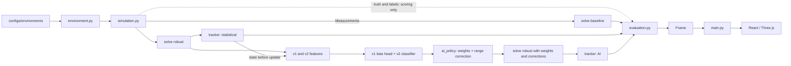

# LOCUS-X — Project Context (updated)

Last updated: 2026-10-24
Project root: `C:\Users\chiranjilalkumawat\Downloads\locus-x-main\locus-x-main`
Branch: `feat/ai-reliability-final` (last commit `4b72560`; **many later changes are uncommitted**, see section M)
Replaces: `PROJECT_CONTEXT.md` (2026-10-21), which predates the whole AI layer and is now wrong about
several basics (no ML model, no `.git`, no `artifacts/`, proxy port 8000).

**Provenance of this document.** Sections marked *[verified 10-24]* were checked against code, saved
artifacts or executed commands on 2026-10-24. Sections marked *[carried over]* come from the
2026-10-21 context and were not re-inspected (mainly the 3-D frontend and building validation).
Numbers are labelled *verified* (re-computed from saved files or re-run) or *reported* (taken from
a project report).

---

## A. Executive summary

LOCUS-X is a **local research workspace for indoor range-based positioning** on a fictional hospital
digital twin. A seeded simulator produces anchor ranges with noise, wall-induced NLOS bias, packet
loss and anchor outages. Every frame computes **three position estimates from identical observations**:

1. **Baseline**: plain nonlinear least squares (NLS).
2. **Statistical LOCUS-X**: Huber-robust NLS with residual-consistency weights, plus a
   constant-velocity Kalman tracker.
3. **AI LOCUS-X** *(new since 10-21)*: a learned per-anchor LOS/NLOS probability turns into solver
   weights, and a learned per-anchor range-bias estimate is subtracted from the ranges before the same
   robust solve and a second Kalman tracker.

All of it is served by a FastAPI backend and shown in a React/Three.js UI. Truth and fault labels are used
only for scoring (and for training the models offline).

**Status in one paragraph** *(details in section K)*: in simulation the AI path is strong with 8 anchors and
NLOS (about 50% lower RMSE than the baseline), weak at 3–4 anchors, and slightly worse than the baseline when there
is nothing to correct (packet loss, clean). The statistical core is worse than the plain baseline under NLOS.
No blind evaluation exists for the current system, and nothing here is validated on real radio hardware.

---

## B. Technology stack *[verified 10-24 unless noted]*

- **Backend:** FastAPI 0.141.1, Starlette 1.5.0, Uvicorn 0.52.1, Pydantic 2.13.4, NumPy 2.2.6,
  SciPy 1.18.0 (pinned in `requirements-lock.txt`). The project targets Python 3.13
  (`pyproject.toml`); the commands in this session ran on **Python 3.14.3** (global install, not `.venv`).
- **AI:** no ML framework. Models are plain **NumPy MLPs** (forward pass in NumPy; training in
  `ai_training.py` with hand-written Adam). Weights are `.npz`.
- **Frontend** *[carried over]*: React 19, TypeScript ~5.7, Vite 6, Three.js 0.175, `@react-three/fiber` 9,
  Vitest 3, ESLint 9.
- **Tooling:** pytest (119 tests, all pass, verified). **Ruff is not installed** on this machine (pip timeouts),
  so lint has not been run since the AI changes.
- **Ports:** `vite.config.ts` currently proxies `/api` to **`http://127.0.0.1:8080`** (changed from 8000 because
  port 8000 is blocked on this machine; uncommitted). Revert to 8000 elsewhere.
- No database, no authentication, no external services. In-memory sessions and jobs.

---

## C. Project structure *[verified 10-24]*

```text
locus-x-main/
├── backend/locus_x/
│   ├── main.py            FastAPI app, 11 routes, session/job stores
│   ├── session.py         SimulationSession: frame lifecycle; runs all three methods
│   ├── schemas.py         API contracts, presets, Frame, AI metadata
│   ├── environment.py     config loading, floor resolution, route_position
│   ├── building.py        V3 Building/Floor schema and validation
│   ├── geometry.py        segment intersection, region coverage
│   ├── simulation.py      seeded range generation + separate FaultLabels
│   ├── estimators.py      baseline and robust solver (+ ai_weights, bias_corrections)
│   ├── tracking.py        constant-velocity Kalman tracker (gate parameter)
│   ├── evaluation.py      truth-based error and 95% coverage
│   ├── benchmark.py       benchmark runner (methods: baseline, proposed, ai)
│   │  ── AI runtime ──
│   ├── reliability.py     v1: 24-feature extractor, MLP, bias head (predict_full)
│   ├── reliability_v2.py  v2: 41-column extractor (26 active), 5-model ensemble
│   ├── ai_policy.py       policy_weights + run_v2_policy (single shared AI pipeline)
│   │  ── AI offline / experiments ──
│   ├── ai_training.py     dataset generation, MLP training, Platt calibration, bias head
│   ├── policy_v2.py       validation-only policy selection; load_policy; --refresh-hash
│   ├── ai_final.py        frozen final-test harness (uses run_v2_policy)
│   ├── ai_ablation_v3.py  ablation of weights / range correction / scaling / gate
│   ├── ai_evidence.py, ai_ablation.py, ai_ablation_diagnostics.py, ai_evaluation.py, ai_phase3.py
│   │                      earlier phase experiments (Phase 1–3 evidence, ablations, v2 selection)
│   ├── oracle_experiments.py  oracle-label experiments (written; never completed a run)
│   └── diagnostics/recall_diagnosis.py   post-hoc NLOS recall diagnosis
├── backend/research/      preserved offline estimator research (depends on missing historical files)
├── backend/tests/         119 tests (core, api, building, audit, ablation, ai_phase3,
│                          phase4_engineering, policy_v2, recall_diagnosis, reliability_v2)
├── configs/environments/  hospital_v3.json (3 floors), hospital_floor_01.json (legacy)
├── configs/benchmarks/    competition.json, v3 smoke, nlos-audit
├── configs/ai/            dataset configs v1/v2, seed manifests (final-test v1/v2,
│                          recall-fix-test-seeds-v1, validation-seeds-extra-v1)
├── models/ai-reliability-v1/   weights.npz (incl. W_bias, b_bias), config.json, metrics.json
├── models/ai-reliability-v2/   seed_2026102{1..5}.npz, config.json, policy-v2.json,
│                               promotion.json, selection.json
├── artifacts/ai-reliability/   experiment outputs (gitignored; see section G)
├── docs/                  architecture, methodology, ai-reliability-*.md reports, v3 docs
├── scripts/               analyze_final.py, build_hospital_v3.py, verify_v3_http.py
├── src/                   React/TypeScript frontend [carried over]
├── results_summary.md/.csv   Phase 4–6 frozen-final-test summary (committed)
└── PROJECT_CONTEXT.md / PROJECT_CONTEXT_UPDATED.md
```

---

## D. Architecture *[verified 10-24]*



- **Style:** layered monolith; the browser is a thin client; all simulation, estimation and evaluation run
  server-side. REST polling, no websockets.
- **Concurrency:** per-session `RLock`, monotonic `revision`, `expected_revision` on every write (stale = HTTP 409).
  One benchmark worker thread; at most one active benchmark job.
- **Truth boundary:** estimators and models receive only `Measurement` (anchor id, anchor position, timestamp,
  observed range), the known map, their own history and the statistical estimate/tracker state. `FaultLabel`
  (true range, injected bias, walls, availability) goes only to `evaluate`. A test asserts the AI path never
  reads `settings.nlos_bias` or `walls_enabled`.
- **Two trackers** per session: one for the statistical fix, one for the AI fix. v2 features use the
  *statistical* tracker's pre-update state, not the AI tracker's.

---

## E. How each part works

### E1. Simulator — `simulation.py` *[verified]*
`generate_measurements(env, settings, position, t, frame_index)` per anchor:
true range; walls crossed by the straight segment; `bias = nlos_bias × min(walls,3)/2` (if walls enabled);
availability precedence **disabled → timed outage (A2/A4/A6/A8 for `anchor_failure`/`chaos`, `12 ≤ t%40 < 22`) →
Bernoulli packet loss**; `observed = max(0.01, true + bias + N(0,σ))`. Per-anchor RNG
`SeedSequence([seed, frame_index, i])`. Returns `Measurement`s and separate `FaultLabel`s. The bias is a
**deterministic** function of wall count, with no randomness; this makes it easy for the models to learn.

### E2. Solvers — `estimators.py` *[verified]*
- `valid_observations`: first occurrence per anchor, drop non-positive/non-finite.
- `solve(measurements, robust, trust, ai_weights, bias_corrections)`:
  needs 3 or more valid anchors; SVD spread check (ratio < 0.025 → `poor_geometry`); algebraic initialisation;
  plain NLS. **If `bias_corrections` is given, the ranges are reduced by it (floor 0.01) before everything else.**
  Robust mode: MAD scale (min 0.2 m), Huber re-solve, consistency weights
  `clip(1/(1+(|r|/2s)²), 0.08, 1)`, weights `0.65·trust + 0.35·instant`, weighted Huber solve.
  **If `ai_weights` is given, those weights replace the statistical ones entirely** (additive coupling, clipped 0..1).
  Final checks: converged, finite, information-matrix condition ≤ 1000; covariance `s²·(JᵀWJ)⁻¹`.
- Status values: `valid`, `insufficient`, `poor_geometry`, `solver_failed`.

### E3. Tracker — `tracking.py` *[verified]*
Constant-velocity Kalman `[x,y,vx,vy]`, white-acceleration process noise 1.2 m/s², measurement covariance =
solver covariance + 0.04·I. `update(estimate, timestamp, gate=13.82)`: reinitialise if no state or no accepted
update for ≥ 3 s; otherwise accept when innovation χ² < `gate`, else prediction only (`degraded`); after 3 s without
an accepted update the position is withheld (`unavailable`). Joseph covariance update; 95% ellipse from covariance.
The gate is a parameter, but the live policy keeps the default 13.82 (a tighter 5.99 variant was tested and removed).

### E4. AI feature extraction and models *[verified]*
- **v1** (`reliability.py`): 24 features per anchor from the statistical fix: normalised range/predicted range,
  residual (m, normalised, absolute), consistency, anchor and relative geometry, bearing, available fraction,
  condition number, **wall count along anchor→estimated-position (map-aware)**, frame mean wall count, consensus
  median/MAD, previous residual and deltas. MLP **24→32→16→1** (ReLU, Platt-calibrated). A **bias head**
  (linear 16→1 on the second hidden layer) predicts the NLOS range error in metres, trained by ridge regression on
  NLOS-only training samples; output clipped at 0. **In the live pipeline only the bias output is used.**
  `predict_full(...)` returns `(ReliabilityOutput, {anchor_id: bias_m})` and advances the feature history once.
- **v2** (`reliability_v2.py`): 41 candidate columns; the promoted **G5** variant uses **26 active features**
  (22 map-free v1 features + 4 reception features); the other 15 inputs have zeroed first-layer weights, so it does
  **not** use wall counts. **Five** MLPs (41→32→16→1), each Platt-calibrated, probabilities averaged. Output:
  `p_los` per anchor. Its built-in weight formula (threshold 0.05) is unused in the live path.
- Training labels: `y = 1` iff the simulator marked the observation NLOS; bias target = injected bias. Packet-loss,
  outage and disabled observations are excluded from supervision.

### E5. Policy and range correction — `ai_policy.py`, `policy-v2.json` *[verified]*
`run_v2_policy(...)` is the single AI pipeline, called by `session.py` and `ai_final.py`:
1. v2 predicts `p_los` per anchor. If it returns no predictions (model missing, fewer than 3 anchors, no statistical
   fix, non-finite features), the AI estimate **falls back to the statistical fix**.
2. `policy_weights` (policy v2.3.0: threshold 0.25, floor 0.08): if fewer than 3 anchors have `p_los ≥ 0.5`
   (majority/all NLOS) the AI **stays active**: predicted-LOS anchors get 1.0, predicted-NLOS get the floor.
   Otherwise `weight = 1` if `p_los ≥ 0.25`, else `0.08 + 0.92·p_los/0.25`. Fewer than 3 anchors, or non-finite
   probabilities, are the only hard fallbacks.
3. **Range correction** (policy `range_correction`, enabled, `min_p_nlos` 0.25): for anchors with `p_nlos > 0.25`,
   `range −= p_nlos × predicted_bias` (bias from the v1 head).
4. `solve(robust=True, ai_weights, bias_corrections)`, then the AI tracker with the default gate.
5. The metadata returned to the UI reports the **applied** weights and status (`active`/`fallback`).
The policy file is hashed (`policy_sha256`); `load_policy` refuses a mismatch. Current policy:
`hard_t025_f008_active_majority_rc`, version **2.3.0**.

### E6. Session — `session.py` *[verified]*
`compute()` per frame: snapshot tracker/trust/feature state → truth from the route → `generate_measurements` →
`solve` baseline → `solve` robust (updates trust) → capture statistical tracker state → statistical tracker update →
AI branch (`predict_full` for bias, `run_v2_policy`; legacy v1-only branch if v2 is unavailable) → AI tracker update →
events → `evaluate` → `Frame`. `update` (controls) replays the same timestamp from the snapshot; route/speed/seed changes
restart. `reset`, `select_floor`, `restart` as before. The default route in `Settings` is now **`held_out`**.

### E7. Evaluation and benchmark *[verified]*
`evaluate` gives baseline/proposed/AI errors, 95% coverage for the tracked estimates, and `has_nlos`/`has_dropout`.
`benchmark.run_benchmark` creates fresh `SimulationSession`s (so it exercises the live AI pipeline) and summarises
three methods: `baseline`, `proposed`, `ai`.

### E8. Frontend *[carried over; AI items spot-checked]*
React shell (`App.tsx`), `useSession.ts` (serial request queue, 0.2 s advance loop), `workspace.ts` (history,
metrics, trajectories incl. AI position), `Diagnostics.tsx` (shows `ai_metadata` status/version and
per-anchor predictions), `Charts.tsx` (baseline/proposed/AI series), `scene/Overlays.tsx` (AI trail),
`Benchmark.tsx`, `Controls.tsx`, `EnvironmentPanel.tsx`. Colours in the legend: amber = baseline, teal =
statistical, purple = AI. Frontend tests were not re-run on 10-24.

---

## F. Workflows

**Live loop:** UI → `POST /sessions/{id}/advance {expected_revision, dt}` → lock → `SimulationSession.advance` →
`compute()` (E6) → `Frame` JSON → UI.

**Benchmark:** `POST /benchmarks` → single worker → `run_benchmark` → poll `GET /benchmarks/{id}`.

**Train a model (offline):** `python -m backend.locus_x.ai_training --generate --train` (flags `--all`, `--epochs`).
Generates `artifacts/ai-reliability/dataset-v1/{train,validation,test}.npz`, trains v1 (validation split 80/20 by run:
early stopping vs Platt calibration), fits the bias head, writes `models/ai-reliability-v1/`.

**Select / refresh policy:** `python -m backend.locus_x.policy_v2 --select` (validation only);
`--refresh-hash` after editing `policy-v2.json` by hand.

**Frozen final test:** `python -m backend.locus_x.ai_final --workers N` writes `artifacts/ai-reliability/final-test/`
and **refuses to overwrite an existing directory** by design.

**Ablation:** `python -m backend.locus_x.ai_ablation_v3 --seeds 2 --workers 4` (validation seeds only) writes
`artifacts/ai-reliability/ablation-v3/summary.json`.

**Other:** `python -m scripts.analyze_final`; `python -m backend.locus_x.diagnostics.recall_diagnosis`;
`LOCUS_X_AI_MODEL_DIR` overrides the v1 model directory.

---

## G. Data, models and artifacts *[verified 10-24]*

- **Datasets** (`dataset-v1`, regenerated 10-24): train 272,027 samples (75,891 NLOS), validation 31,596,
  test 63,776; includes `bias_magnitude`.
- **Models:** v1 weights **retrained 10-24 in place** (still labelled `ai-reliability-v1`, now with bias head
  and a separate calibration split); v2 unchanged since 10-22 (5 checkpoints, SHA-checked at load).
- **Seed manifests:** final-test seeds 8001–8081 are **consumed** (committed frozen run on 10-23). Seeds
  **12001–12037** (`configs/ai/recall-fix-test-seeds-v1.json`) are reserved and unevaluated. Validation seeds 11 and 22
  have driven most design decisions.
- **Artifacts present:** `ablation-v1`, `ablation-v3`, `audit-phase0`, `competition-ai-v1/v2`, `dataset-v1`,
  `evidence-v1-fresh`, `final-evaluation`, `final-freeze`, `final-test` (**incomplete, see M**),
  `final-test-invalid-mask` (preserved invalid pre-run), `final-test-v2` (catalog only), `oracle-experiments`
  (empty), `phase3-v2`, `phase4-final`, `recall-diagnosis`, `reference-existing`, `policy-tuning.json`.

---

## H. Algorithms in one place

Range model → plain NLS (baseline) → Huber + consistency weights (statistical) → Kalman (both trackers) →
AI: v2 ensemble `p_nlos` → floor/threshold weights; v1 bias head → `p_nlos × bias` subtracted from ranges →
weighted robust NLS → Kalman. Metrics: RMSE, median, P95, valid/update rate, 95% ellipse coverage, latency.
A paired, run-clustered bootstrap (2,000 resamples) is used for all comparisons.

---

## I. API reference *[verified 10-24 against `main.py`, `schemas.py`]*

Base path `/api/v1`. No authentication, no CORS (use the Vite proxy or same origin). FastAPI also serves
`/docs` and `/openapi.json`. If `dist/` exists at import, it serves `/`, `/assets/*`, `/locus.svg`.

| Method | Path | Request body | Response | Errors |
|---|---|---|---|---|
| GET | `/health` | none | `{status, version "3.0.0", engine}` | none |
| GET | `/environments` | none | `{environments[], presets, coordinate_system}` | none |
| POST | `/sessions` | `SessionCreate`: `environment_id` (default `hospital_floor_01`), `floor_id?`, `settings` | `Frame` (201) | 404 unknown environment, 422 invalid settings, 429 at 64 sessions |
| GET | `/sessions/{id}` | none | `Frame` | 404 |
| DELETE | `/sessions/{id}` | none | 204 | none |
| POST | `/sessions/{id}/advance` | `Advance`: `expected_revision`, `dt` (0.05–1, default 0.2) | `Frame` | 404, 409 stale revision, 422 |
| PATCH | `/sessions/{id}/controls` | `Controls`: `expected_revision` + any of `scenario`, `noise_std` (0–3), `nlos_bias` (0–10), `dropout` (0–1), `disabled_anchors`, `walls_enabled`, `route`, `speed` (0.2–3), `seed` | `Frame` | 404, 409, 422 |
| POST | `/sessions/{id}/reset` | `Revision`: `expected_revision` | `Frame` | 404, 409 |
| POST | `/sessions/{id}/floor` | `FloorSelection`: `expected_revision`, `floor_id` | `Frame` | 404, 409, 422 |
| POST | `/benchmarks` | `BenchmarkRequest`: `environment_id`, `floor_id?`, `scenarios`, `anchor_counts` (3/4/6/8), `seeds` (≤4), `steps` (10–400), `dt` (0.1–1), `route` (`asset_round`/`held_out`, default `held_out`); at most 25,000 frames | `BenchmarkJob` (202) | 404, 409 job already running, 422 |
| GET | `/benchmarks/{id}` | none | `BenchmarkJob`: `{id, status, progress, result, error}` | 404 |

**`Settings`:** `scenario` (clean, noise, high_noise, nlos, packet_loss, anchor_failure, chaos; a preset fills
`noise_std`/`nlos_bias`/`dropout`, explicit fields override), `disabled_anchors`, `walls_enabled`, `route`
(default `held_out`), `speed` 1.2, `seed` 12.

**`Frame`:** identity (`session_id`, `environment_id/version/sha256`, `floor_id`, `floor_elevation`,
`localization_mode "2d_on_known_floor"`), `revision`, `frame_index`, `timestamp`, `settings`, `anchors`,
`measurements`, `simulator_labels`, `baseline`, `robust`, `tracking`, **`ai`**, **`ai_tracking`**,
**`ai_metadata`** (`status active/fallback`, `reason`, `model_version`, `feature_version`, `ambiguous`,
`n_predicted_los/nlos`, `predictions[{anchor_id, p_los, weight}]`, `runtime_ms`), `evaluation`
(`ground_truth`, `baseline_error`, `proposed_error`, `ai_error`, `covered_95`, `ai_covered_95`, `has_nlos`,
`has_dropout`), `events`.

Notes: `ai_metadata.predictions[].weight` is the **applied** policy weight. `/health`'s `engine` string still
describes only "robust ranges + Kalman tracking" (does not mention the AI layer).

---

## J. Running the project

```powershell
cd C:\Users\chiranjilalkumawat\Downloads\locus-x-main\locus-x-main     # the INNER folder (has package.json)
python -m uvicorn backend.locus_x.main:app --host 127.0.0.1 --port 8080   # 8000 is blocked on this machine
npm run dev                                                               # Vite; picks the next free port
python -m pytest backend/tests -q                                         # 119 pass (verified 10-24)
```
Windows PowerShell 5.1 does not support `&&`; chain with `;`. Keep a single Uvicorn worker (in-memory state).
Frontend verification (`npm run typecheck/lint/test/build`) and `ruff` were not run on 10-24.

---

## K. Project status *[verified unless marked reported]*

### K1. Results

| Result | Value | Source |
|---|---|---|
| Frozen final test, 3,456 runs, seeds 8001–8081 *(reported; derived files in git)* | Baseline 2.710, statistical 3.277, v1 3.302, v2 3.294 m. v2 vs statistical **+0.50%** (CI +0.35…+0.67), rejected. Statistical was **+14.5%** worse than baseline on matched frames | `results_summary.md`, `docs/ai-reliability-final.md` |
| Ablation, validation seeds 11/22, 432 runs, 51,840 frames *(verified)* | Baseline 2.47, weights-only 2.92, **+ range correction 1.86**, all-three 2.01 m. Gate regresses (+0.066 m); anchor-count scaling inert | `artifacts/ai-reliability/ablation-v3/summary.json` |
| Live API, NLOS 8 anchors *(verified)* | Baseline 1.50, statistical 1.94, **AI 0.68 m**; chaos 3.60 / 4.02 / 1.85; 3–4 anchors only about 10% better; packet loss 7% worse | live backend runs |
| Bias head held-out RMSE on NLOS samples *(verified)* | validation 1.22, test 1.26 m (constant 1.89/2.00; wall-count lookup 1.43/1.40) | recomputed |
| Bias-scale shift, 8 anchors, bias 1/2.5/5/8 *(verified)* | AI 0.50/0.70/0.91/1.38 vs baseline 0.58/1.53/3.62/5.80 m | recomputed |
| Bias-rule perturbation *(verified)* | 8 anchors: AI still wins. 4 anchors with random per-frame bias: AI 2.73 vs baseline 2.42 (**loses**) | recomputed |
| Pipeline decomposition, NLOS 8 anchors *(verified)* | plain NLS 1.53 → +Huber 1.86 → +weights 1.95 → +Kalman 2.01 m | recomputed |
| Tracker covariance *(verified)* | error²/trace(cov) about 10.7 (calibrated about 1); 95% coverage 0.05–0.47 (statistical), 0.43–0.89 (AI) | recomputed |
| Tests | 119 backend tests pass | verified |

### K2. What works
- Learned range correction: the only large, significant effect; scales across bias magnitude; survives a misspecified
  bias rule at 8 anchors.
- v2 classifier + floor weights recover part of the damage the statistical solver does (NLOS-only 8 anchors).
- Majority/all-NLOS frames no longer disable the AI (hard fallbacks remain only for fewer than 3 anchors, no
  statistical fix, non-finite features, model missing).
- Protocol discipline: preregistration, frozen manifests, paired bootstrap, preserved invalid run.

### K3. Open problems (ranked)
1. **P0, provenance:** raw final-test arrays deleted; freeze hashes no longer match the working tree; large
   uncommitted change set; v1 model overwritten in place under the same name (section M).
2. **P0, no blind test** for the current system. Use seeds 12001–12037, frozen policy, full `ai_final` protocol.
3. **P1, statistical solver loses to the baseline under NLOS** (the Huber step costs about 0.33 of 0.48 m).
4. **P1, tracker** hurts at 3–4 anchors; covariance ignores unmodelled bias (overconfident).
5. **P1, sparse anchors:** 4 anchors about 1.9–2.1 m under NLOS and loses to baseline under bias mismatch.
6. **P1, simulator realism:** bias is deterministic in wall count; in-dataset F1 0.92–0.97 vs final-test recall 0.67.
7. **P2:** two-model AI path (v1 only for bias); no accuracy regression test; ruff/frontend tests not rerun;
   small regressions on packet loss (+7%) and clean (0.05 m tracker error).

### K4. Planned next steps
Restore and commit the work; decompose the solver/tracker error (plain NLS vs Huber vs weights); test tracker variants
at 3–4 anchors; build a bias-family generalisation suite; train a map-free bias regressor on v2 features (a ridge
prototype got validation/test RMSE 1.00/1.15 m without wall counts, better than the current head's 1.22/1.26;
not yet tested end-to-end); preregister and run once on seeds 12001–12037.

### K5. Real-world readiness
None claimed. Would require real UWB captures with independent ground truth, several buildings and materials, real
multipath and packet loss, and on-device latency.

---

## L. Testing and verification

- Backend (verified 10-24): `python -m pytest backend/tests -q` → **119 passed**. New tests cover policy weights,
  anchor-count scaling, the frozen policy contents, majority-NLOS gating and correction, no simulator-config reads in the
  AI path, applied-weight reporting, and the three-method identical-observation invariant (now spying on both
  `session.solve` and `ai_policy.solve`).
- Not verified on 10-24: frontend typecheck/lint/tests/build, ruff, browser/WebGL behaviour.
- Latency (verified, single process, all three methods plus v1 and v2): about 16.6 ms per frame mean, p95 about 20 ms. The
  frozen test reported 24.6 ms (statistical) and 38.8 ms (v2) measured under 18 parallel workers; not comparable.

---

## M. Incidents, drift and knowledge gaps

- **Deleted artifacts:** on 10-24 `artifacts/ai-reliability/final-test/` was removed with `rm -rf` to make room for a new
  run. The 12 derived result files are tracked in git (`git checkout -- artifacts/ai-reliability/final-test` restores them).
  `frames.npz` (33 MB) and `classifier-samples.npz` (22 MB) were never committed and are **lost**; they can be
  regenerated by running the frozen command at commit `5aef613`. The folder currently holds only a stray
  `run-catalog.json` from an aborted rerun.
- **Freeze chain broken in the working tree:** policy hash `4c38a30b…` and `ai_final.py` hash in
  `final-freeze/manifest.json` no longer match. The frozen results correspond to commit `5aef613` / `4b72560`.
- **Uncommitted work:** 17+ tracked files modified (about +986/−688 lines) plus new files (`ai_policy.py`,
  `ai_ablation_v3.py`, `oracle_experiments.py`, `diagnostics/`, tests). Nothing since `4b72560` is committed.
- **Docs drift:** `docs/ai-reliability-final.md`, `results_summary.md` and `README.md` still say the runtime adapter
  is v1 and v2 was rejected. The live runtime now uses v2 + the v1 bias head under policy 2.3.0.
- **Local environment changes:** Vite proxy to 8080; default route `held_out`; Python 3.14 outside `.venv`.
- **Unknown:** real-hardware behaviour; whether the map-free bias head improves end-to-end positioning; the classifier
  ceiling under the current design (oracle experiments never completed).

---

## N. Glossary additions

| Term | Meaning |
|---|---|
| **p_los / p_nlos** | v2 ensemble's calibrated probability that an anchor's range is line-of-sight / blocked |
| **Bias head** | Linear layer on v1's hidden layer predicting an anchor's NLOS range error in metres |
| **Range correction** | `range − p_nlos × predicted_bias` applied before the solve |
| **Policy** | Rule mapping `p_los` to solver weights, plus correction settings; versioned and hashed |
| **Majority-NLOS branch** | When fewer than 3 anchors look LOS, AI stays active with floor weights on NLOS anchors |
| **Additive coupling** | AI weights replace the statistical weights instead of multiplying them |
| **Frozen final test** | The preregistered 3,456-run evaluation on seeds 8001–8081 (consumed) |
| **Reserved seeds** | 12001–12037, unevaluated; the only clean test data left |
| **Matched baseline check** | Comparison restricted to frames where the baseline produced a fix |

---

## O. Developer quick reference

| Task | Files |
|---|---|
| Change AI weighting / correction / fallback | `ai_policy.py`, `models/ai-reliability-v2/policy-v2.json` (then `--refresh-hash`) |
| Change classifier features | `reliability_v2.py` (and retrain; checkpoints are SHA-checked) |
| Change the bias head | `ai_training.py: fit_bias_head`, `reliability.py: predict_full` |
| Change solver math | `estimators.py` (keep identical-observation invariant) |
| Change tracker | `tracking.py` (gate parameter, process noise) |
| Wire AI into the live session | `session.py: compute` |
| Add an API field | `schemas.py`, then `src/types.ts` |
| Add an experiment | copy `ai_ablation_v3.py`; never reuse consumed seeds |

Coupling to remember: `schemas.py` is the contract hub; `session.py` and `ai_policy.py` define behaviour for the UI, the
benchmark and the frozen harness at once; any change to the estimator, tracker or policy invalidates comparability with
past results, so version the policy and write a new freeze manifest rather than editing old ones.
