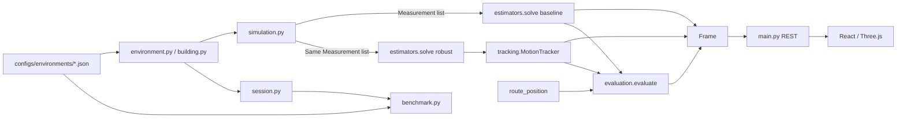

# LOCUS-X — Project Context

Last updated: 2026-10-21  
Project root: `C:\Users\chiranjilalkumawat\Downloads\locus-x-main\locus-x-main`  
Purpose of this document: persistent, evidence-based orientation for future developers/AI sessions.  
Scope: read-only investigation of the repository; no application source was modified.

---

## A. Executive summary

LOCUS-X is a **local research workspace for indoor range-based positioning**, built around a **fictional hospital digital twin**. It compares:

1. **Baseline** — 2-D range-only localization using algebraic initialization plus nonlinear least squares.
2. **LOCUS-X** — the same observations, but with Huber robust estimation, residual-consistency weights, and a constant-velocity Kalman filter.

The app also provides a React/Three.js hospital viewer, live error metrics, CSV/scenario exports, and a separate reproducible benchmark runner.

**Problem addressed:** indoor positioning cannot rely on GPS; the project studies how range observations behave under noise, wall-induced NLOS bias, packet loss, anchor outages, and combined faults. It demonstrates a complete synthetic loop from geometry → simulated ranges → estimation → tracking → evaluation → visualization.

**Primary users:** the project team/judges/students exploring indoor-localization robustness. It is a research/demo tool, not a clinical or production system.

**Implemented status (verified from code):**
- 2-D localization on a **manually selected, known floor**; no vertical estimation and no automatic floor transitions.
- Three-floor fictional building (`hospital_v3`) plus the preserved legacy single-floor environment.
- Deterministic synthetic range generation, two estimators, Kalman tracking, evaluation, REST API, React/Three.js UI, benchmark job/CLI.
- No trained ML model, no anchor optimizer, no real UWB/BLE ingestion, no database, no authentication, no persistent experiment library.
- Python and frontend tests are present and documented as passing; this checkout has **no installed dependencies**, so tests were not re-executed during this investigation.

---

## B. Technology stack

### Backend
- Python 3.13 target (`pyproject.toml`), tested per README on Python 3.13.13.
- FastAPI `0.141.1`, Starlette `1.5.0`, Uvicorn `0.52.1`.
- Pydantic `2.13.4` for strict API/configuration validation.
- NumPy `2.2.6`, SciPy `1.18.0` for estimation and linear algebra.
- pytest `9.1.1`, pytest-cov, Ruff `0.17.0`, httpx.
- No database or external services. In-memory sessions/jobs.

### Frontend
- React `19`, React DOM `19`, TypeScript `~5.7.3`.
- Vite `6`, `@vitejs/plugin-react`.
- Three.js `0.175`, `@react-three/fiber` `9.1.2`.
- Lucide React icons; bundled IBM Plex Sans and JetBrains Mono fonts.
- Vitest `3`, ESLint `9`, typescript-eslint.
- No CDN, image service, external API, websocket, or runtime credentials.

### Tooling / configuration
- `package.json` scripts: `dev`, `build`, `preview`, `typecheck`, `lint`, `test`.
- Vite proxies `/api` to `http://127.0.0.1:8000`.
- pytest configured in `pyproject.toml` with `testpaths = ["backend/tests"]`.
- Ruff target `py313`, line length 100, rules `E,F,I,B,UP`.
- No `AGENTS.md` or equivalent instruction file exists in this checkout.
- No CI/CD configuration, Dockerfile, or deployment manifest exists.

---

## C. Project structure

```text
locus-x-main/
├── backend/
│   ├── locus_x/                 Production engine
│   │   ├── main.py              FastAPI app, endpoints, session/job stores
│   │   ├── session.py           Authoritative session state and frame lifecycle
│   │   ├── schemas.py           API contracts, settings presets, frame/estimate models
│   │   ├── environment.py       Load legacy/V3 configs, floor resolution, route motion
│   │   ├── building.py          V3 Building/Floor schema and topology validation
│   │   ├── geometry.py          Segment intersection and exact region coverage
│   │   ├── simulation.py        Seeded synthetic range/measurement generation
│   │   ├── estimators.py        Baseline + robust range-only solver
│   │   ├── tracking.py          Constant-velocity Kalman filter, gating, ellipse
│   │   ├── evaluation.py        Truth-based error and covariance coverage
│   │   └── benchmark.py         Reproducible experiment runner + CSV/JSON CLI
│   ├── research/                Preserved offline research candidates
│   │   ├── candidates.py        Alternative estimator experiments
│   │   ├── experiment.py        Split-based replay experiment
│   │   └── diagnose.py          Reproduces known NLOS failure
│   └── tests/                   Backend test suite
├── configs/
│   ├── environments/
│   │   ├── hospital_v3.json     Runtime source for 3-floor building
│   │   └── hospital_floor_01.json  Preserved legacy 30×20 m floor
│   └── benchmarks/
│       ├── competition.json     Full historical 7×4×2×160 protocol
│       ├── v3/*-smoke.json      Per-floor functional smoke runs
│       └── nlos-audit/protocol.json  Frozen research split plan
├── docs/                        Architecture, methodology, contracts, audits, status
│   └── presentation-prep/       Presentation scripts/question bank (not runtime)
├── public/locus.svg             App icon
├── scripts/
│   ├── build_hospital_v3.py     Deterministic V3 fixture authoring
│   └── verify_v3_http.py        Live API/proxy verification
├── src/
│   ├── main.tsx, App.tsx        Frontend entry and application shell
│   ├── useSession.ts            Serial HTTP session state and polling loop
│   ├── workspace.ts             Floor/view/layer/metrics/trajectory helpers
│   ├── lib.ts                   Coordinate mapping, fetch, CSV, history
│   ├── types.ts                 TypeScript mirrors of API contracts
│   ├── Controls.tsx             Scenario/fault/anchor/route controls
│   ├── EnvironmentPanel.tsx     Environment/floor/layer sidebar
│   ├── Diagnostics.tsx          Live comparison and per-anchor diagnostics
│   ├── Benchmark.tsx            Benchmark job UI and result tables
│   ├── Charts.tsx               SVG error/CDF charts
│   ├── Scene.tsx                React Three Fiber scene composition
│   ├── scene/                   Architecture, overlays, camera, primitives
│   └── *.test.ts(x)             Frontend unit/SSR contract tests
├── package.json / lockfile
├── requirements.txt / requirements-lock.txt
├── pyproject.toml, tsconfig.json, vite.config.ts, eslint.config.js
├── index.html
├── README.md, CONTRIBUTING.md
└── APEX_PPT_2.0.pptx            Presentation file (binary; not runtime)
```

Generated/absent in this checkout: `node_modules/`, `.venv/`, `dist/`, `artifacts/`, `.git/`. Historical benchmark artifacts referenced by docs are **not present**.

---

## D. Architecture

### High-level flow



### Architectural style
- Small **layered monolith**: configuration/schema → simulation → estimation/tracking → evaluation → session/API → UI.
- Browser is a thin client; **all simulation, estimation, and truth evaluation happen server-side**.
- REST polling with a serial client queue, not WebSockets.
- Sessions are authoritative server objects protected by a per-session `RLock` and monotonic revision. Browser writes send `expected_revision`; stale writes get HTTP 409.
- Benchmarks run in a separate single-worker `ThreadPoolExecutor`, independent of live sessions.

### Module responsibilities
| Module | Responsibility |
|---|---|
| `environment.py` | Load/validate JSON catalog, select floor, interpolate target route by simulation time |
| `building.py` | V3 floor/building schema, topology/route/door/core validation |
| `geometry.py` | Closed segment intersection, rectangle bounds, exact segment-union coverage |
| `simulation.py` | Seeded ranges, wall bias, dropout, timed outages, separate fault labels |
| `estimators.py` | Input validation, geometry checks, algebraic init, NLS, Huber, consistency weights |
| `tracking.py` | CV Kalman filter, innovation gate, coasting/timeout, covariance ellipse |
| `evaluation.py` | Independent truth error and 95% region coverage |
| `session.py` | Settings, time/frame index, trust/filter state, compute/update/reset/floor lifecycle |
| `main.py` | FastAPI routes, session/job stores, locks, static dist serving |
| `benchmark.py` | Independent multi-scenario protocol, summaries, traces, CLI exports |

### Truth boundary (important)
The estimator receives only `Measurement(anchor_id, anchor_position, timestamp, observed_range)`. Simulator-only `FaultLabel` includes true range, injected bias, wall IDs, availability kind, and is emitted separately (`simulation.py:9-55`). Both estimators receive the **same measurement list object** (`session.py:54-57`). `tracking` receives only the robust `Estimate`. Evaluation runs afterward. This boundary is asserted by tests (`backend/tests/test_core.py:196-220`, `test_audit.py:202-237`).

---

## E. File-by-file documentation

### Backend production code

#### `backend/locus_x/schemas.py`
Public Pydantic contracts. `StrictModel` forbids extra fields and non-finite values (`:11-13`).
- `Anchor`, `Wall`, `Room`, `Waypoint`, `Environment` (`:15-61`); `Environment.validate_geometry` checks unique anchor IDs, non-empty routes with ≥2 waypoints, and all geometry within floor bounds.
- `Settings` (`:64-81`): scenario, noise, NLOS bias, dropout, disabled anchors, wall propagation, route, speed, seed. A `before` validator applies `PRESETS` (`:65-71`), with explicit request fields overriding preset values.
- `PRESETS` (`:84-92`): clean, noise, high_noise, nlos, packet_loss, anchor_failure, chaos.
- Request models: `SessionCreate`, `Controls`, `Advance`, `Revision`, `FloorSelection` (`:95-124`).
- Estimator input `Measurement` (`:127-133`) — deliberately excludes truth/labels.
- `FaultLabel` (`:136-142`), `Estimate` (`:145-153`), `Ellipse` (`:156-160`), `Tracking` (`:163-173`), `Evaluation` (`:176-182`), `Event`, `Frame` (`:185-210`).
- `BenchmarkRequest` (`:213-233`): scenario list, anchor counts `3|4|6|8`, seeds, steps, dt, route literal `asset_round|held_out`; bounds total work to 25,000 frames.
- `Frame.localization_mode` is fixed to `"2d_on_known_floor"`.

#### `backend/locus_x/building.py`
V3 composition while preserving legacy `Environment`.
- `BuildingRoom` adds required `id`; `Region`, `AccessCore`, `Door` (`:12-36`).
- `Floor` extends `Environment` (`:38-50`) adding presentation metadata, rooms, corridors, doors, cores, movement-region references, candidate anchors, layout ID, route names.
- `Floor.validate_floor` (`:52-155`) checks unique IDs across groups, candidate/installed separation, region bounds/overlap, movement references, route-name coverage, candidate bounds, wall length, door width/references/jamb endpoints/wall-free interiors, core entry/door matching, and **complete route segments** against walls and movement regions (including loop closure).
- `ConnectionStop`, `FloorConnection`, `ValidationMetadata` (`:158-173`).
- `Building` (`:176-232`): unique/ascending floors, footprint fit, slab/wall clearance, unique connections, stops referencing matching aligned cores, one connection per core.

#### `backend/locus_x/environment.py`
- `CONFIG_DIR` points to `configs/environments` (`:10`).
- `load_environments` (`:13-22`) loads sorted `*.json`, chooses `Building` when `schema_version == "3.0"`, otherwise `Environment`; rejects duplicate IDs.
- `resolve_floor` (`:25-35`) selects a floor manually; never infers floor.
- `floor_elevation` (`:38-39`).
- `route_position` (`:42-60`) builds segment durations from waypoint dwell plus Euclidean distance/speed; time is modulo route period. Handles dwells, interpolation, and loop closure.

#### `backend/locus_x/geometry.py`
- `intersects` (`:6-21`): closed segment intersection including collinear overlap.
- `rectangle_bounds` (`:24-30`).
- `segment_in_regions` (`:33-58`): exact interval coverage by a union of rectangles, not sampled points; used for route validation.

#### `backend/locus_x/simulation.py`
`generate_measurements` (`:9-55`) for each anchor:
- Per-anchor RNG `SeedSequence([seed, frame_index, anchor_index])` so disabling one anchor does not perturb others.
- True Euclidean range; wall IDs intersected by the direct segment.
- Bias `nlos_bias * min(wall_count, 3) / 2` when walls enabled.
- Availability order: disabled anchor → timed outage (A2/A4/A6/A8 during `12 <= t % 40 < 22` for `anchor_failure`/`chaos`) → Bernoulli packet loss.
- Observed range `max(0.01, true_range + bias + noise)`.
- Returns separate `observations` and `labels`.

#### `backend/locus_x/estimators.py`
- `valid_observations` (`:11-24`): first occurrence per anchor ID, drops nonpositive/non-finite ranges and non-finite coordinates/timestamps.
- `solve` (`:27-107`):
  1. Requires ≥3 valid anchors.
  2. SVD spread check; rejects collinear/nearly collinear (`singular[1]/singular[0] < 0.025`).
  3. Algebraic initialization via differenced squared ranges and `lstsq` (`:49-56`).
  4. Baseline NLS minimizing `||p - a_i|| - r_i` (`:45-57`).
  5. Robust mode: MAD scale, Huber candidate solve, instantaneous consistency `clip(1/(1+(|r|/(2s))²), 0.08, 1)`, exponential trust `0.65*previous + 0.35*current`, weighted Huber re-solve (`:60-79`).
  6. Reject failed/non-finite result; local information matrix condition >1000 rejected.
  7. Covariance `s² * inv(JᵀWJ)`, residuals, reliability, condition number, runtime.
- No imports from `simulation` or `evaluation`.

#### `backend/locus_x/tracking.py`
- `covariance_ellipse` (`:13-22`): eigen-decomposition; semiaxes `sqrt(5.9914645 * eigenvalue)`; angle from major eigenvector.
- `MotionTracker.update` (`:32-96`):
  - State `[x,y,vx,vy]`; prediction with `F[0,2]=F[1,3]=dt`.
  - Process noise with acceleration columns, `1.2² * G Gᵀ`.
  - Measurement covariance = robust covariance + `0.04 I`.
  - Reinitialize if no state or ≥3 s since last accepted update.
  - Otherwise normalized innovation squared gate `< 13.82`.
  - Joseph covariance update.
  - Rejected/missing fix = prediction only, status `degraded` until 3 s, then `unavailable` with null position/ellipse.
  - Reacquisition after outage initializes position and resets velocity uncertainty.

#### `backend/locus_x/evaluation.py`
`evaluate` (`:9-26`) computes Euclidean errors only for available positions, empirical coverage using `deltaᵀ cov⁻¹ delta <= CHI2_95_2D`, and `has_nlos`/`has_dropout` flags. Missing positions produce `None`, never zero error.

#### `backend/locus_x/session.py`
`SimulationSession` (`:16-180`):
- Creation captures environment, resolved floor, environment hash, deep-copied initial settings, revision 0, time 0, tracker/trust, event log, and computes the initial frame.
- `validate_settings` (`:38-44`) rejects duplicate/unknown disabled anchors and unknown routes.
- `compute` (`:46-106`) snapshots pre-frame tracker/trust, obtains truth from route, generates identical measurements, runs baseline and robust solve, updates tracker, appends status/outage events, and builds a `Frame`.
- `advance` (`:112-117`) advances rounded timestamp, frame index, revision, recomputes.
- `reset` (`:119-123`) restores creation floor + settings then `restart`.
- `select_floor` (`:125-140`) resolves floor, adjusts route/disabled anchors, then restarts a fresh 2-D run; same-floor request is idempotent.
- `restart` (`:142-158`) resets time/index/tracker/trust/events and recomputes.
- `update` (`:160-180`) merges preset defaults, validates, restarts only for route/speed/seed changes; otherwise restores the pre-frame tracker/trust snapshot and recomputes once at the same timestamp to avoid double-counting observations.

#### `backend/locus_x/main.py`
FastAPI app and stores:
- Module import loads/validates environments (`:29`), initializes in-memory `sessions`, `jobs`, `store_lock`, single benchmark executor (`:30-33`).
- `GET /api/v1/health` (`:59-65`).
- `GET /api/v1/environments` (`:68-74`) returns catalog, presets, coordinate convention.
- Session endpoints (`:86-147`): create, get, delete, advance, controls, reset, floor. Mutations check revision inside the per-session lock; 409 stale, 422 invalid, 404 unknown.
- Session store keeps ≤64 sessions and evicts >1 h idle on create (`:95-101`).
- Benchmark endpoints (`:150-198`): start validates environment/floor/route/A1–A8, rejects concurrent jobs, keeps ≤5 jobs, queues a worker, returns job; poll returns status/progress/result.
- If `dist/` exists at import, serves `/assets`, `/`, `/locus.svg` (`:201-211`); otherwise only API is served.

#### `backend/locus_x/benchmark.py`
- `ANCHOR_SELECTION` (`:18-23`): 3/4/6/8 anchor subsets are named A1–A8.
- `summarize` (`:26-54`): RMSE, median, P95, valid rate, update rate, NLOS/dropout RMSE, mean latency, empirical coverage.
- `run_benchmark` (`:57-162`): loops scenarios × anchor counts × seeds × steps; creates a fresh `SimulationSession`; skips t=0 evaluation; records per-frame evaluation and runtimes; first seed supplies trace; returns rows/traces/distributions plus environment hash/version/floor metadata.
- CLI `main` (`:165-197`): reads config, chooses timestamped unique output or explicit new directory, refuses to overwrite existing `results.json`/`metrics.csv`, writes both, prints summary.

### Frontend

#### `src/types.ts`
TypeScript interfaces mirroring the REST contracts: environment/floor/building, settings, estimate, frame, sample, benchmark row/result/job. Note: backend `Tracking` includes `state_covariance`, but the frontend type omits it; the UI does not use it.

#### `src/lib.ts`
- `toScene([x,y], elevation) -> [x,elevation,-y]`; `fromScene` inverse (`:4-5`).
- Formatting helpers, scenario display names.
- `ApiError` + `request` wrapper; 30 s timeout; extracts FastAPI `detail`; handles 204 (`:10-23`).
- Blob download, CSV serialization with escaping/missing values, history append/replacement/cap 600 (`:24-45`).

#### `src/workspace.ts`
- View/layer types and defaults; truth/signal layer coupling (`:22-24`).
- Legacy floor adaptation with presentation metadata only; geometry arrays are reused by reference (`:31-38`).
- `floorForFrame` rejects environment/floor/elevation mismatch (`:40-45`).
- Display elevation and visible floor selection for floor/building/exploded modes (`:47-54`).
- View reducer for mode/angle/floor/reset/zoom (`:56-67`).
- `settingsKey` for history reset; includes session/environment/floor/settings.
- `recordFrame` builds a truthful sample; resets history when configuration changes (`:76-86`).
- `windowMetrics` computes RMSE, median, P95, valid/update rates, latency, coverage with independent denominators (`:88-109`).
- `trajectorySegments` breaks paths across missing values/floor changes (`:112-120`).
- `ellipsePoints` rotates backend-plane ellipse before scene mapping (`:122-129`).

#### `src/useSession.ts`
Hook owning catalog/frame/history/running/error/busy:
- One serial promise queue for all mutations (`:33-54`).
- `connect` loads `/environments`, tries stored session ID, else creates `hospital_v3` or first environment (`:56-71`).
- `accept` validates frame against catalog/floor, updates state, stores session ID in `sessionStorage`, records history.
- `mutate` sends expected revision; on 409 it refetches the current frame while preserving the original error (`:44-49`).
- Running loop requests 0.2 s advances with 150 ms delay (`:100-110`).
- Environment switch creates a replacement session before deleting the old one; floor switch pauses and resets the run; reset/step helpers.

#### `src/App.tsx`
Application shell and layout:
- Header/nav, Twin/Benchmarks tabs, Help dialog.
- Lazy-loads the 3-D `Scene` chunk (`:12`).
- Run/pause/reset/step controls; only 0.2 s fixed steps.
- Floor/building/exploded and plan/perspective controls; fit/zoom/expand.
- Scene layers, diagnostics toggle, live chart, events panel, CSV/scenario exports.
- Single-column adaptive layout; `activeView` forces floor mode for legacy single-floor environments.

#### `src/Controls.tsx`
- Scenario preset selector; noise, NLOS bias, packet-loss sliders with commit-on-release/keyboard/blur; wall-bias toggle.
- Anchor enable/disable buttons using functional updates; shows current availability.
- Route select generated from floor config (no hardcoded route names), speed/seed inputs with validation.
- Notes that route/speed/seed edits restart time and reset restores creation state.

#### `src/EnvironmentPanel.tsx`
- Environment select, floor list with elevation/room count, experiment/layers tabs.
- Layer checkboxes grouped by architecture/infrastructure/experiment; unavailable layers disabled when geometry is absent.
- Cutaway toggle; candidate-site count disclosure; layer reset.

#### `src/Diagnostics.tsx`
- Current baseline/LOCUS-X error, comparison table (RMSE/median/P95/valid/update/latency/coverage), tracker status/position/velocity/condition/outage, per-anchor range/residual/label/weight table.
- Derives window metrics independently from returned samples.
- Explicitly shows baseline coverage as N/A.

#### `src/Charts.tsx`
SVG error-over-time chart with gaps for missing values, hover/keyboard inspection, and empirical CDF chart from sampled quantiles.

#### `src/Benchmark.tsx`
Separate benchmark workspace:
- Environment/floor/scenario/scope controls; always requests seeds 101/202, 160 frames, 0.5 s, held-out route, anchor counts 3/4/6/8.
- Starts async job, polls every 800 ms, shows progress, result table, error/CDF charts, metrics CSV and full JSON export.
- Handles completed results from previous runs; shows a message if selected scenario was not part of that run.

#### `src/Scene.tsx` and `src/scene/*`
- `Scene` renders an orthographic R3F canvas with demand rendering, shadows, DPR cap 1.5, and an error boundary.
- Geometry is data-driven from the selected environment/floor.
- `Architecture` builds instanced slabs/rooms/walls/doors/cores/equipment and labels; cutaway is visual only.
- `Anchors` shows installed anchors with simulator status, and candidate sites separately.
- `ExperimentOverlays` draws planned route, simulated signal rays, truth/baseline/proposed trails, markers, and ellipse.
- `CameraRig` implements orbit/pan, plan view, auto-fit, relative zoom, reduced-motion handling.
- `Primitives` provides instanced solids, canvas-texture labels, and polylines with disposal.
- `architectureGeometry` cuts access-core openings from slabs and generates decorative room equipment.

### Tests
- `backend/tests/test_core.py`: numerical exactness, noise, insufficient anchors, degenerate geometry, solver failure, wall/door geometry, NLOS/bias, determinism, outages, route behavior, reset/control recompute, filter coasting, ellipse scaling, truth isolation, benchmark reproducibility.
- `backend/tests/test_api.py`: health/catalog, full lifecycle, invalid controls, unknown environment/extra fields, preset initialization, async benchmark job.
- `backend/tests/test_building.py`: legacy hash preservation, floor elevations, route/door walkability, 18 invalid-building cases, non-finite rejection, region-union gaps, candidate isolation, floor switch/reset atomicity, legacy default, per-floor benchmark isolation, all floors reuse `Environment`, CLI artifact protection.
- `backend/tests/test_audit.py`: malformed scenarios, duplicate anchors, fault controls, custom reset, insufficient/collinear geometry, truth/label isolation, numerical initialization failures.
- `src/lib.test.ts`: coordinate round-trip, history replacement/reset, CSV missing/identity/escaping.
- `src/workspace.test.tsx`: legacy adaptation, frame/floor matching, view modes, coordinate round-trips, slab openings, ellipse rotation, view/layer logic, trajectory gaps, truthful window metrics, 600 cap, SSR control contracts.

### Configuration and scripts
- `configs/environments/hospital_v3.json`: Meridian Hospital, 42×28 m, floors ground/first/second at 0/4.2/8.4 m, 8 anchors, 21 candidates per floor, 10/10/8 rooms, corridors/doors/cores, two routes per floor. Generated by `scripts/build_hospital_v3.py`.
- `configs/environments/hospital_floor_01.json`: legacy 30×20 m, 8 anchors, 6 rooms, 2 routes; hash preserved by tests.
- `configs/benchmarks/competition.json`: 7 scenarios × 4 anchor counts × 2 seeds × 160 steps, held-out route.
- `configs/benchmarks/v3/*-smoke.json`: clean/NLOS/chaos, 8 anchors, seeds 17/29, 60 steps per floor.
- `scripts/build_hospital_v3.py`: deterministic authoring only; writes `hospital_v3.json`.
- `scripts/verify_v3_http.py`: exercises health/catalog/session/advance/floor/controls/reset/delete for all floors and legacy default; can target Vite proxy.

---

## F. End-to-end workflows

### 1. Backend startup
1. Uvicorn imports `backend.locus_x.main`.
2. `load_environments()` scans `configs/environments/*.json`, validates each as `Building` or `Environment` (`environment.py:13-22`, `main.py:29`). Invalid configuration fails startup.
3. FastAPI app is created; benchmark executor and in-memory stores are initialized.
4. If `dist/` exists at import, static assets/index/icon are mounted (`main.py:201-211`).
5. No environment variables or credentials are read.

### 2. Browser startup / reconnect
1. `main.tsx` mounts `<App/>`.
2. `useSession` `connect()` requests `/api/v1/environments`.
3. It checks `sessionStorage['locus-x-v3-session']`; if present, `GET /sessions/{id}`. A 404 falls through to a new session.
4. New sessions prefer `hospital_v3`, else the first catalog environment; POST `/sessions` with `{environment_id}`.
5. `accept()` verifies the frame's environment/floor/elevation against the catalog, stores the session ID, updates React state, and seeds history.
6. UI shows loading/error/telemetry accordingly.

### 3. Live experiment step (the core loop)
1. User presses Run. `useSession` starts a recursive timer.
2. Each tick calls `POST /sessions/{id}/advance` with `expected_revision` and `dt=0.2`.
3. `main.advance_session` → `mutate` acquires session lock, checks revision, calls `session.advance`.
4. `advance` increments simulation time/frame index/revision, then `compute`:
   - `route_position` computes target truth at simulation time.
   - `generate_measurements` creates available ranges + separate fault labels.
   - `solve(measurements)` computes baseline.
   - `solve(measurements, robust=True, trust=self.trust)` computes robust estimate and updates trust.
   - `MotionTracker.update` fuses the robust fix into the motion state (or coasts).
   - `evaluate` computes errors/coverage after inference.
5. The `Frame` returns over HTTP.
6. `useSession.accept` updates frame/history; `recordFrame` resets history if the session/environment/floor/settings identity changed, otherwise appends (same timestamp replaces; cap 600).
7. UI re-renders scene overlays, diagnostics, and charts. Rendering time does not affect simulation time.

### 4. Control edit
1. Control sends `PATCH /sessions/{id}/controls` with expected revision and changed fields.
2. `SimulationSession.update` merges scenario preset first, then explicit fields.
3. Validates disabled anchors/route.
4. If route/speed/seed changed → `restart` (time/filter/trust reset, edited settings retained).
5. Otherwise increments revision, restores the pre-frame tracker/trust snapshot, recomputes once at the same timestamp, and adds an event.
6. This prevents the same measurement from being counted twice and avoids filter-state drift.

### 5. Reset
`POST /reset` restores the **creation floor and creation settings**, clears tracker/trust/events, sets time/index 0, increments revision, and recomputes. Custom API-created settings are restored, not browser defaults.

### 6. Floor switch
`POST /floor` validates revision/floor, chooses a valid route and filters disabled anchors, replaces the environment with the selected `Floor`, and restarts a fresh 2-D run. No tracker state crosses floors. Same-floor selection returns the current frame.

### 7. Benchmark
1. User configures environment/floor/scenario/scope in `Benchmark.tsx`.
2. `POST /benchmarks` validates environment/floor/route/A1–A8 and creates a queued job.
3. Single benchmark worker calls `run_benchmark`.
4. For each scenario/count/seed, it creates a fresh `SimulationSession` using preset + named anchor subset, advances `steps` times at `dt`, and records evaluation/runtime.
5. Summaries are pooled across seeds; traces use the first seed; distributions use valid errors.
6. UI polls `GET /benchmarks/{id}` until complete/failed, then renders table/charts and offers CSV/JSON export.

### 8. Exports
- **Scenario JSON**: current environment/floor/settings, replayable via `POST /sessions`.
- **Window CSV**: history samples with errors, floor identity, update flags, runtimes, coverage, truth/estimate positions.
- **Benchmark metrics CSV / full JSON**: independent run output.

---

## G. Data and database design

There is **no database**. All state is in memory and validated JSON configuration.

### Configuration model
`Building (3.0)` → ordered `Floor`s → anchors, walls, rooms, routes + V3 additions (corridors, doors, access cores, movement regions, candidate anchors, route names). `FloorConnection` links aligned stair/lift cores across floors. Legacy `Environment` remains the reused base geometry contract.

### Runtime state
`SimulationSession`: ID, configuration, selected floor, initial/current settings, environment hash, revision, frame index, simulation timestamp, `MotionTracker`, trust weights, event ring (last 20), per-session lock, idle timestamp, current `Frame`, pre-frame tracker/trust snapshot.

`Frame` contains: identities/hash/floor/elevation/mode, revision/index/time, settings, anchors, measurements, simulator labels, baseline/robust estimates, tracking, evaluation, events.

`BenchmarkJob`: ID, status, progress, result/error; at most 5 jobs; one active job.

### Data lifecycle
- Session creation → initial frame at t=0.
- Advance → new frame, revision +1.
- Control → same timestamp recompute or restart.
- Reset → initial floor/settings, t=0, fresh tracker/trust.
- Floor switch → selected floor, t=0, fresh tracker/trust.
- Delete → removed from memory.
- Backend restart → all sessions/jobs lost.
- Idle eviction on session creation: >1 h.
- Session cap: 64.

### Persistence and caching
- No persistent storage.
- Browser keeps at most 600 samples in memory; session ID in `sessionStorage`; no plot persistence across reload.
- Environment definitions are loaded once at backend import; edit JSON then restart backend.

---

## H. Algorithms and business logic

### 1. Route motion
Piecewise-linear closed loop with per-waypoint dwell; constant speed; simulation time modulo route period. Abrupt turns/stops are intentional stressors (`environment.py:42-60`).

### 2. Synthetic range model
`r = max(0.01, ||target - anchor|| + b·min(wall_intersections,3)/2 + Normal(0,σ))`, with `b = nlos_bias` only if wall bias enabled. Availability precedence: manual disable → timed outage → packet loss. Per-anchor seeded RNG makes surviving observations stable when anchors are toggled. Fault labels are simulator-only.

### 3. Baseline localization
- Validate/normalize observations.
- Require ≥3 distinct anchors and non-collinear geometry via SVD ratio.
- Algebraic initialization by differencing squared ranges.
- NLS `sum((||p-a_i|| - r_i)^2)`, max 100 evaluations.
- Reject failed/non-finite solutions and information-matrix condition >1000.
- Return position, residuals, covariance proxy, condition, runtime.
- No clamping to the floor footprint.

### 4. Robust localization
- Same initialization.
- MAD scale `max(0.2, 1.4826·MAD(residuals))`.
- Huber candidate solve.
- Instantaneous consistency weight `clip(1/(1+(|r_i|/(2s))²), 0.08, 1)`.
- Temporal trust `w_i = 0.65·previous + 0.35·instant`; missing anchors do not update.
- Weighted Huber re-solve; covariance `s²·(JᵀWJ)⁻¹`.
- These are heuristic consistency weights, **not** probabilities, LOS labels, or a trained model.

### 5. Kalman tracking
- State `[x,y,vx,vy]`; constant-velocity transition.
- White-acceleration process noise with `1.2 m/s²`.
- Position measurement = robust estimate; covariance + `0.04 I`.
- Normalized innovation squared gate 13.82 (≈99.9% 2-D chi-square).
- Joseph covariance update.
- Prediction-only during rejected/missing fixes; `degraded` until 3 s without accepted update, then `unavailable` and position/ellipse withheld.
- Reacquisition after timeout reinitializes position and velocity uncertainty.
- Not an EKF, not map-constrained, and no route/truth input.

### 6. Uncertainty region
Covariance eigen-decomposition; semiaxes `sqrt(5.9914645471·eigenvalue)`; nominal 95% 2-D Gaussian ellipse. Empirical coverage checks `errorᵀ cov⁻¹ error <= 5.9914645471`. Display is a model-based region, not calibrated confidence.

### 7. Benchmark metrics
RMSE, median, P95 over valid outputs; valid rate = valid frames / all evaluated frames; update rate = accepted updates / all frames (for baseline, position availability; see caveat in K); NLOS/dropout-conditioned RMSE; mean solver latency; empirical coverage over available ellipses. Missing errors stay missing. Frames are correlated, so pooled frame metrics are not independent trials.

### 8. Historical measured results (documentation only)
README records 8-anchor pooled RMSE over seeds 101/202 on the legacy floor:

| Scenario | Baseline | LOCUS-X |
|---|---:|---:|
| Clean LOS | ~0 | 0.050 |
| Moderate noise | 0.285 | 0.266 |
| High noise | 0.853 | 0.783 |
| NLOS bias | 1.540 | 1.968 |
| Packet loss | 0.216 | 0.214 |
| Anchor outage | 0.160 | 0.155 |
| Combined failures | 3.640 | 3.782 |

Documented NLOS 95%-ellipse coverage: 49.4%; combined: 36.3%. The project explicitly states the proposed method does **not** always win. These numbers are not independently reproducible from this checkout because `artifacts/` is absent.

---

## I. API and integration reference

Base path: `/api/v1`. Authentication: **none**. Intended binding: localhost. No CORS middleware; use Vite proxy or same-origin built app.

| Method | Path | Request | Response | Notes |
|---|---|---|---|---|
| GET | `/health` | — | `{status,version,engine}` | Engine readiness |
| GET | `/environments` | — | `{environments,presets,coordinate_system}` | Union of legacy floor/building |
| POST | `/sessions` | `SessionCreate` | `Frame` (201) | Empty body selects legacy floor |
| GET | `/sessions/{id}` | — | `Frame` | Current authoritative frame |
| DELETE | `/sessions/{id}` | — | 204 | Removes in-memory session |
| POST | `/sessions/{id}/advance` | `{expected_revision,dt?}` | `Frame` | dt 0.05–1, default 0.2 |
| PATCH | `/sessions/{id}/controls` | `{expected_revision,...changes}` | `Frame` | Preset + explicit fields; route/speed/seed restart |
| POST | `/sessions/{id}/reset` | `{expected_revision}` | `Frame` | Creation floor/settings restored |
| POST | `/sessions/{id}/floor` | `{expected_revision,floor_id}` | `Frame` | Fresh 2-D run on selected floor |
| POST | `/benchmarks` | `BenchmarkRequest` | `BenchmarkJob` (202) | Async, one active job |
| GET | `/benchmarks/{id}` | — | `BenchmarkJob` | Status/progress/result |

Error behavior: 404 unknown session/environment/job; 409 stale revision or concurrent benchmark; 422 invalid parameters/floor/route; 429 session capacity.

Request/response contracts are defined in `schemas.py`. `BenchmarkRequest` route is currently restricted to `asset_round` or `held_out`; benchmark anchor subsets are hardcoded to A1–A8 names.

External integrations: **none**. Fonts and icons are bundled. No telemetry, cloud, hardware, or third-party runtime API.

---

## J. Configuration and running instructions

### Prerequisites
- Python 3.13 (README tested 3.13.13).
- Node 22.12+ (tested Node 24.14.0).
- Windows PowerShell commands are the validated path; macOS/Linux commands are documented but not exercised in the project history.

### First-time setup
```powershell
python -m venv .venv
.\.venv\Scripts\python.exe -m pip install -r requirements-lock.txt
npm.cmd ci
```

### Run backend
```powershell
.\.venv\Scripts\python.exe -m uvicorn backend.locus_x.main:app --host 127.0.0.1 --port 8000
```

### Run frontend
```powershell
npm.cmd run dev -- --port 5173 --strictPort
```
In the restricted Windows sandbox described by the docs, add `--configLoader native`.

Open `http://127.0.0.1:5173`; API docs at `http://127.0.0.1:8000/docs`.

### Single-server demo
```powershell
npm.cmd run build
```
Restart the backend, then open `http://127.0.0.1:8000`. Keep one Uvicorn worker because state is in memory.

### Environment variables / secrets
None required. No `.env` or credential files are present. API keys, passwords, and private keys were not found. `.gitignore` covers `.env`, caches, `.venv`, `node_modules`, `dist`, `artifacts`, logs.

### Configuration changes
- `configs/environments/hospital_v3.json` is the runtime source. Restart backend after editing.
- `scripts/build_hospital_v3.py` deterministically regenerates `hospital_v3.json`; direct edits are overwritten if the script is rerun.
- `hospital_floor_01.json` is intentionally preserved and hash-tested.

### Verify commands (documented in README; not run here)
```powershell
.\.venv\Scripts\python.exe -m pytest --cov=backend.locus_x --cov-report=term-missing -q
.\.venv\Scripts\python.exe -m ruff check backend/locus_x backend/tests scripts
.\.venv\Scripts\python.exe -m ruff format --check backend/locus_x backend/tests scripts
npm.cmd run typecheck
npm.cmd run lint
npm.cmd test
npm.cmd run build
```

### Benchmarks
```powershell
.\.venv\Scripts\python.exe -m backend.locus_x.benchmark --config configs/benchmarks/competition.json
```
V3 smoke runs use `configs/benchmarks/v3/{ground,first,second}-smoke.json`. New outputs go to unique timestamped directories; existing `results.json`/`metrics.csv` are protected.

---

## K. Bugs, risks, and technical debt

No critical defect was confirmed by static inspection within the documented local single-user scope. The following are confirmed limitations, validation gaps, or risks. "Confirmed" means visible in code/configuration; severity assumes the documented local demo context unless stated otherwise.

| # | Severity | Location | Finding / evidence | Why it matters / recommendation |
|---|---|---|---|---|
| 1 | High if publicly exposed; otherwise Low | `backend/locus_x/main.py` all routes | No authentication, authorization, rate limiting, CORS, or tenant isolation; benchmark jobs consume CPU. | Anyone who can reach the port can create sessions/benchmarks and read simulator truth. Keep bound to localhost; add auth/rate limits before any shared deployment. |
| 2 | Medium | `estimators.py`, `tracking.py`, README/methodology | Documented NLOS underperformance and severe nominal-95% undercoverage; covariance is a local approximation and shared positive bias can be overconfident. | Algorithmic limitation, not a code typo. Report valid/update rates and coverage together; calibrate covariance on independent data before claiming confidence. |
| 3 | Medium | `schemas.py:225`, `main.py:159-160`, `benchmark.py:18-23` | Benchmark protocol hardcodes `asset_round|held_out` and A1–A8 subsets. | Custom V3 routes/layouts and optimizer-produced anchors cannot be benchmarked without a new protocol. Add explicit-layout mode and versioned protocol before optimizer work. |
| 4 | Medium | `backend/research/candidates.py:17-26` | Research loader imports files from `artifacts/nlos-audit/reference/*.py`, but `artifacts/` is absent in this checkout. | Research scripts fail unless historical artifacts are restored. Document/restore artifacts or vendor the reference modules. |
| 5 | Medium | Verification status | No dependency installation, browser surface, or WebGL acceptance in this checkout; docs themselves record a browser-validation gap. | Unit tests and HTTP checks do not prove UI rendering/interactions. Complete a browser pass at desktop/mobile widths before sign-off. |
| 6 | Low | `building.py:223-224` | Connection alignment validation compares only core `center` and `size`, not `entry`. | A future config could pass validation with mismatched door entry points. Include `entry` in alignment checks. |
| 7 | Low | `building.py:93-97` | Candidate anchors are only bounds-checked; they may overlap walls, cores, or impractical locations. | Documented as non-certified sites, but an optimizer could select infeasible points. Add static feasibility checks before optimization. |
| 8 | Low | `estimators.py:63-72` | Huber candidate solve's `success` is not checked before using `candidate.x`; only the final solve is checked. | A failed intermediate fit can degrade the weighted solve. Check candidate success/finite output and fall back explicitly. |
| 9 | Low | `main.py:112-115` | `DELETE /sessions/{id}` removes the session under `store_lock` but not the per-session lock. | An in-flight mutation can finish after deletion; no data corruption, but ambiguous lifecycle. Acquire the session lock before deletion or mark deleted. |
| 10 | Low | `benchmark.py:49, 93-95` | Baseline `update_rate` counts valid positions; proposed counts accepted filter updates. | Semantics differ by method. Document clearly or report baseline "valid solve rate" separately. |
| 11 | Low | `session.py:130-140` | Floor switch builds new settings via `model_copy` and does not call `validate_settings` afterward. | Currently safe because route/anchor IDs are chosen from the target floor, but future schema changes could bypass validation. Validate after the update. |
| 12 | Low | `main.py:201-203` | Static mount occurs only if `dist/` exists at import; assumes `dist/assets` exists. Building after startup requires restart. | Expected for Vite, but a partially built `dist` can prevent startup. Validate asset directory or fail with a clear message. |
| 13 | Low | `src/useSession.ts:29` | `sessionStorage.setItem` is not guarded. | Privacy/restricted-storage modes can throw during frame acceptance. Wrap in try/catch and degrade to in-memory reconnect. |
| 14 | Low | `src/types.ts:52-56` vs `schemas.py:163-173` | Backend `Tracking` returns `state_covariance`; the TS type omits it. | Harmless now, but a contract drift. Add the field or explicitly document it as server-only. |
| 15 | Low | Docs links | `docs/v3-status.md` and others reference `artifacts/...` evidence that is not in this checkout. | Future readers cannot verify claims locally. Restore/link artifacts or mark them separately distributed. |
| 16 | Low | Build output (documented) | Three.js scene chunk is large (~900 kB minified / ~244 kB gzip in the report) and Vite emits an advisory. | Affects first load; consider code-splitting/compressing geometry if deployment matters. |
| 17 | Info | `session.py`, `main.py` | In-memory sessions/jobs; no DB/persistence; one Uvicorn worker supported. | Backend restart loses all state. Do not scale across workers without external state/locking. |
| 18 | Info | `simulation.py`, docs | Synthetic independent Gaussian noise, deterministic positive wall bias, independent packet loss, scripted outages. | Does not model real multipath, correlated loss, hardware, clock drift, or 3-D propagation. No real-radio claims. |
| 19 | Info | `session.py`/UI | Manual known-floor 2-D mode only; floor switches reset tracking. | No automatic floor detection, vertical state, cross-floor ranging, or transition handoff. |
| 20 | Info | `backend/research` | Preserved research code has known lint/format findings and is excluded from production checks. | Keep separate; clean up only with explicit ownership and preserved evidence. |

Potential runtime issues not verified: browser rendering/WebGL behavior, real-world latency under load, concurrent-request races beyond the covered tests, and actual numerical results since dependencies/artifacts are absent.

---

## L. Testing and verification

### What exists
- Backend: 4 test modules covering core math, API lifecycle, building validation, and audit regressions.
- Frontend: Vitest tests for coordinate/CSV/history, workspace/view/layer/metrics, and server-rendered control contracts.
- Scripts: `scripts/verify_v3_http.py` for live API/proxy checks.
- Docs record prior executed results: backend 70 passed / 93% coverage; frontend 24 passed; typecheck/lint/build/ruff passed; reference benchmark reproduced. These are **project-reported**, not independently rerun here.

### Performed during this investigation (non-destructive)
- Parsed every project Python file with `ast.parse`: all passed.
- Parsed every project JSON file (excluding `package-lock.json`): all passed.
- No packages installed, no servers started, no test suite executed, no files modified except creating this document.

### Not verified here
- pytest/Ruff/TypeScript/ESLint/Vitest/build (dependencies absent).
- Browser interaction, WebGL rendering, responsive layout, keyboard focus, exports.
- Live HTTP behavior.
- Historical benchmark numbers (artifacts absent).
- Real radio/hardware, deployment, multi-worker behavior.

---

## M. Knowledge gaps

1. **Historical artifacts absent**: `artifacts/benchmark`, `artifacts/v3-foundation`, and `artifacts/nlos-audit` are referenced but not present. Claimed reference numbers cannot be reproduced or compared locally.
2. **Git history absent**: the checkout has no `.git`; branch/commit provenance in docs cannot be verified.
3. **Presentation file**: `APEX_PPT_2.0.pptx` is binary and was not inspected. `docs/presentation-prep/*` was only mapped by headings; it is presentation material, not runtime truth.
4. **No browser/WebGL verification** in this session; visual correctness and interaction behavior remain unverified.
5. **No real-radio data or hardware**: the simulator's realism is intentionally limited.
6. **No optimizer/model**: handoff documents only; no trained reliability model or anchor optimizer exists.
7. **No deployment/CI**: no Docker, CI, reverse-proxy, TLS, auth, or persistence design.
8. **Dependency compatibility**: versions are pinned and documented, but installation/runtime on this machine was not exercised.
9. **`backend/research` runtime**: depends on missing historical reference modules under `artifacts/`.
10. **Exact historical benchmark runtime/performance** is machine-dependent and not reproducible from source alone.

---

## N. Project glossary

| Term | Meaning |
|---|---|
| **Anchor** | Known-position range sensor/beacon. Installed anchors A1–A8 produce measurements; candidate anchors C01–C21 are non-emitting sites. |
| **Floor / Building** | V3 `Floor` extends the legacy `Environment`; `Building` composes floors at configured elevations. |
| **Known floor** | The user manually selects the floor; localization is 2-D within it. Elevation is configuration, not inference. |
| **LOS / NLOS** | Line-of-sight vs obstructed range. NLOS injects positive wall-intersection bias. |
| **UWB / BLE** | Real radio technologies the synthetic model approximates conceptually; none is integrated. |
| **Measurement** | The only estimator input: anchor ID, anchor position, timestamp, observed range. |
| **FaultLabel** | Simulator-only truth about availability, LOS/NLOS, walls, true range, injected bias. Never an estimator input. |
| **Baseline** | NLS localization without robust weighting or motion filtering. |
| **LOCUS-X method** | Robust Huber solve + residual-consistency trust weights + Kalman tracking. |
| **Huber loss** | Robust loss that limits outlier influence; scale derived from MAD. |
| **Trust / reliability weight** | Heuristic relative residual consistency, not a probability or trained classifier. |
| **Kalman filter** | Linear constant-velocity motion filter over position fixes. |
| **Innovation gate** | Chi-square threshold (13.82) rejecting motion-inconsistent fixes. |
| **Joseph form** | Numerically stable covariance update `(I-KH)P(I-KH)ᵀ + KRKᵀ`. |
| **Coasting / degraded** | Prediction-only tracking while fixes are rejected/missing. |
| **Unavailable** | After 3 s without an accepted update, position/ellipse are withheld. |
| **Nominal 95% ellipse** | Gaussian model region from covariance; not calibrated empirical confidence. |
| **Coverage** | Fraction of available tracking positions inside the nominal ellipse. |
| **RMSE / P95** | Root mean square error / 95th percentile error over valid estimates. |
| **Valid rate / update rate** | Available positions ÷ frames / accepted updates ÷ frames. |
| **Frame** | One authoritative server response containing settings, observations, estimates, tracking, evaluation, events. |
| **Revision** | Monotonic session version used for optimistic concurrency (409 on stale writes). |
| **Session** | In-memory authoritative experiment state for one browser run. |
| **Benchmark job** | Async independent experiment with progress/result; separate from live sessions. |
| **Smoke run** | Small functional per-floor benchmark, not an accuracy improvement claim. |
| **Movement region** | Room/corridor rectangle references used to validate routes are walkable. |
| **Access core** | Stair/lift footprint; aligned vertically across floors; not traversed by the simulator. |
| **Dwell** | Time the target stays at a route waypoint. |
| **Cutaway** | Visual-only reduced wall height; does not change propagation. |
| **Exploded view** | Visual-only vertical spacing between floors. |

---

## O. Developer quick reference

### Where features live
| Feature | Primary files |
|---|---|
| Add/change API fields | `backend/locus_x/schemas.py`, then `src/types.ts` |
| Session lifecycle/revision/reset | `backend/locus_x/session.py`, `main.py` |
| Range/noise/NLOS/outage model | `backend/locus_x/simulation.py` |
| Baseline/robust estimator | `backend/locus_x/estimators.py` |
| Kalman tracking/ellipse | `backend/locus_x/tracking.py` |
| Error/coverage evaluation | `backend/locus_x/evaluation.py` |
| Building/floor validation | `backend/locus_x/building.py`, `geometry.py` |
| Environment loading/route motion | `backend/locus_x/environment.py` |
| Benchmark protocol/summaries | `backend/locus_x/benchmark.py`, `configs/benchmarks/*` |
| Hospital geometry | `configs/environments/hospital_v3.json`, `scripts/build_hospital_v3.py` |
| Browser session/polling | `src/useSession.ts` |
| Scene/overlays/camera | `src/Scene.tsx`, `src/scene/*` |
| Controls/diagnostics | `src/Controls.tsx`, `src/EnvironmentPanel.tsx`, `src/Diagnostics.tsx` |
| Metrics/history/coordinates | `src/workspace.ts`, `src/lib.ts` |
| Benchmark UI | `src/Benchmark.tsx`, `src/Charts.tsx` |
| API/proxy config | `backend/locus_x/main.py`, `vite.config.ts` |

### Common tasks and files to inspect first
- **Change estimator math**: `estimators.py`, `tracking.py`, `session.py`, `methodology.md`, estimator/tracking tests. Preserve the truth boundary and identical-observation invariant.
- **Change a scenario/preset**: `schemas.py` `PRESETS`, `simulation.py`, `Controls.tsx` labels/notes, `benchmark.py` assumptions.
- **Change the hospital**: prefer `scripts/build_hospital_v3.py`, regenerate `hospital_v3.json`, run `test_building.py`. Never edit the legacy fixture.
- **Add a route**: config JSON/authoring script, `route_names`, movement-region validation, `Controls.tsx` (already data-driven), benchmark schema (currently restricted to two route literals).
- **Add an API endpoint**: `schemas.py` + `main.py` + `session.py`; add API tests; update `types.ts`/`useSession.ts` if the UI uses it.
- **Change UI layout**: `App.tsx`, `styles.css`, `EnvironmentPanel.tsx`, `Diagnostics.tsx`; keep missing-value/`N/A` semantics.
- **Change scene geometry**: `scene/Architecture.tsx`, `architectureGeometry.ts`, `Overlays.tsx`; keep geometry visibility independent from propagation settings.
- **Change history/metrics**: `workspace.ts`, `lib.ts`; preserve reset-on-configuration-change, same-timestamp replacement, 600 cap, and missing-value gaps.

### Tests to run
From project root after installing dependencies:
```powershell
.\.venv\Scripts\python.exe -m pytest -q
.\.venv\Scripts\python.exe -m ruff check backend/locus_x backend/tests scripts
.\.venv\Scripts\python.exe -m ruff format --check backend/locus_x backend/tests scripts
npm.cmd run typecheck
npm.cmd run lint
npm.cmd test
npm.cmd run build
```
Focused backend tests: `pytest backend/tests/test_core.py -q`, `test_api.py`, `test_building.py`, `test_audit.py`.
Focused frontend: `npm.cmd test -- src/workspace.test.tsx src/lib.test.ts` (plus `--configLoader native` in the documented sandbox).

### Debugging common failures
- **Frontend shows "engine unavailable"**: start FastAPI on 127.0.0.1:8000; check `/api/v1/health`; Vite proxy must target port 8000.
- **404 on session reconnect**: session was deleted or backend restarted; the app creates a new session automatically on 404.
- **409 stale revision**: another mutation won; the client refetches and displays the error. Do not send concurrent advances.
- **422 invalid controls**: check disabled-anchor duplicates/unknown IDs, route name, value ranges.
- **Position disappears**: tracking is `unavailable` after 3 s without an accepted update; check measurements/anchor count/geometry.
- **`poor_geometry`**: fewer than 3 usable anchors or near-collinear layout.
- **NLOS worse than baseline**: known algorithm limitation under broad positive bias; not a frontend bug.
- **Benchmark 409**: another benchmark is queued/running; wait for completion.
- **`dist/` not served**: build first, then restart backend; static mount happens at import.
- **Config not updating**: backend loads JSON once at import; restart it.
- **Research scripts fail**: restore `artifacts/nlos-audit/reference` first.

### Tight coupling / change-impact map
- `schemas.py` is the contract hub: backend requests/frames and frontend `types.ts` must remain consistent.
- `session.py` couples simulation, estimators, tracking, evaluation, and API frame shape. Changes there can affect live UI, tests, and benchmark results.
- Estimator/tracker changes invalidate historical comparability; use new benchmark versions, never relabel old results.
- `workspace.ts` metrics/history semantics are mirrored by `Diagnostics.tsx` and tests; changing denominators or reset rules affects all live metrics.
- Scene overlay logic depends on `Frame` fields (`tracking.position/ellipse`, `evaluation.ground_truth`, `measurements`, `simulator_labels`); contract changes ripple into `Scene.tsx`, `Overlays.tsx`, `Diagnostics.tsx`, and `types.ts`.
- Building validation and geometry generation must stay in sync with `hospital_v3.json`; route/door/core edits can fail startup.
- Benchmark protocol and named anchor subsets are shared by CLI and API; changing them changes result comparability.

---

## Inspection checklist

### Fully inspected
- [x] All production backend modules: `schemas.py`, `environment.py`, `building.py`, `geometry.py`, `simulation.py`, `estimators.py`, `tracking.py`, `evaluation.py`, `session.py`, `main.py`, `benchmark.py`.
- [x] All backend tests: `test_core.py`, `test_api.py`, `test_building.py`, `test_audit.py`.
- [x] All research modules: `candidates.py`, `experiment.py`, `diagnose.py`.
- [x] All frontend source: `main.tsx`, `App.tsx`, `useSession.ts`, `workspace.ts`, `lib.ts`, `types.ts`, `Controls.tsx`, `EnvironmentPanel.tsx`, `Diagnostics.tsx`, `Benchmark.tsx`, `Charts.tsx`, `HelpDialog.tsx`, `Scene.tsx`, all `scene/*`.
- [x] Frontend tests: `lib.test.ts`, `workspace.test.tsx`.
- [x] All configs: environments, competition, V3 smoke, NLOS audit protocol.
- [x] Build/config files: `package.json`, `tsconfig.json`, `vite.config.ts`, `eslint.config.js`, `pyproject.toml`, `requirements.txt`, `requirements-lock.txt`, `index.html`, `.gitignore`.
- [x] Scripts: `build_hospital_v3.py`, `verify_v3_http.py`.
- [x] Core docs: README, CONTRIBUTING, architecture, methodology, assumptions/limitations, build-status, integration-audit, V3 audit/contract/handoff/status.
- [x] Full `styles.css` (logic-relevant layout/responsive sections).
- [x] `public/locus.svg`.

### Skimmed / not exhaustively inspected
- [ ] `docs/presentation-prep/*` — headings and purpose mapped; presentation content not audited line-by-line.
- [ ] `APEX_PPT_2.0.pptx` — binary presentation; not opened.
- [ ] `package-lock.json` — dependency manifest resolved by npm; not audited entry-by-entry.
- [ ] `README.md` documentation claims vs historical artifacts — artifacts absent, claims cannot be reproduced locally.

### Not present / not applicable
- [ ] `node_modules/`, `.venv/`, `dist/`, `artifacts/`, `.git/`, CI/deployment files — absent in this checkout.
- [ ] Database migrations/schema — no database.
- [ ] ML model/dataset/training pipeline — not implemented.
- [ ] Real radio/hardware integration — not implemented.
- [ ] Authentication/authorization — not implemented.

---

## Evidence boundary

- Statements about current code behavior are based on direct source inspection with line references where useful.
- Statements about test/build/benchmark results are **project-reported** in README/docs unless explicitly said to have been run here. Only Python AST parsing and JSON parsing were executed during this investigation.
- Historical benchmark numbers and artifact links cannot be independently verified in this checkout because `artifacts/` is absent.
- No secrets, credentials, or private keys were found or exposed.
