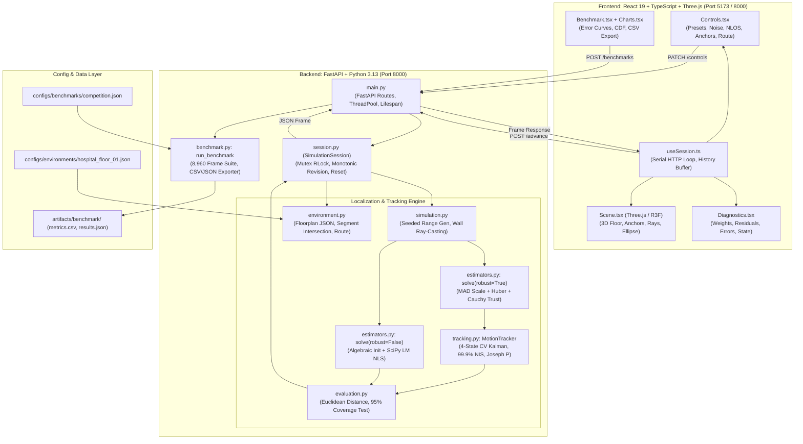

# 02 — Architecture & Algorithms

## 1. System Architecture & Data Flow

### A. Implemented Component Architecture



---

### B. Detailed Data-Flow Sequence

```
1. SCENARIO CONFIGURATION (UI / API)
   - User sets scenario preset or manually adjusts sliders: noise σ, NLOS bias b, dropout p, disabled anchors.
   - Captured in Settings pydantic model.

2. SIMULATED ENVIRONMENT & KINEMATICS (environment.py)
   - Canonical 30 × 20 m hospital floor geometry with walls and door openings.
   - Target trajectory: route_position(route, timestamp, speed). Evaluates piecewise-linear segments and dwell times.
   - Produces ground-truth target position p* = (x*, y*).

3. SYNTHETIC RANGE GENERATION (simulation.py)
   - For each anchor i:
     - SeedSequence([seed, frame_index, i]) creates independent deterministic random generator.
     - True distance: d_i = ||p* - a_i||.
     - 2D ray-segment intersection against all floorplan walls.
     - Injected bias: bias_i = b * min(num_walls, 3) / 2.
     - Fault evaluation: Disabled -> Timed Outage (12-22s) -> Bernoulli Dropout -> Available.
     - If available: observed_range = max(0.01, d_i + bias_i + N(0, σ²)).
   - STRICT BOUNDARY: Returns two separate arrays:
     a) measurements = [Measurement(anchor_id, anchor_pos, timestamp, observed_range)]
     b) simulator_labels = [FaultLabel(anchor_id, available, kind, walls, true_range, bias)]

4. BASELINE LOCALIZATION (estimators.py: solve(robust=False))
   - Filters invalid measurements (< 3 anchors, nonpositive ranges).
   - Verifies 2D anchor spread via SVD singular value ratio >= 0.025.
   - Algebraic linear initialization via differencing squared ranges (np.linalg.lstsq).
   - Nonlinear least-squares optimization: minimizes sum((||p - a_i|| - r_i)²) via SciPy least_squares.
   - Computes baseline position fix p_base.

5. ROBUST LOCALIZATION & TRUST ESTIMATION (estimators.py: solve(robust=True))
   - Starts from baseline initial fix.
   - Computes raw residuals e_i = ||p_base - a_i|| - r_i.
   - Robust scale estimation via Median Absolute Deviation: s = max(0.2, 1.4826 * median(|e - median(e)|)).
   - First Huber-loss solve to establish unweighted candidate position.
   - Instantaneous Cauchy-like consistency weights: q_i = clip(1 / (1 + (|e_i| / (2s))²), 0.08, 1.0).
   - Exponential smoothing with prior anchor trust: w_i = 0.65 * trust_prev + 0.35 * q_i.
   - Second Huber solve with weighted residuals: minimizes sum(Huber(sqrt(w_i) * e_i)).
   - Generates robust position fix p_robust and local covariance matrix Σ_robust = (Jᵀ W J)⁻¹ * s².

6. TEMPORAL MOTION TRACKING (tracking.py: MotionTracker)
   - State vector: x = [x, y, vx, vy]ᵀ.
   - Prediction step: x_pred = F * x, P_pred = F * P * Fᵀ + Q.
   - Measurement update:
     - 2D Normalized Innovation Squared (NIS) test against χ²(2) 99.9% gate (13.82).
     - If NIS < 13.82: Compute Kalman gain K, update state, apply Joseph-form covariance update. Status: 'tracking'.
     - If NIS >= 13.82: Reject measurement fix. Retain predicted state x_pred and growing P_pred. Status: 'degraded'.
     - If elapsed time since last update >= 3.0 s: Withhold position output (position = null, ellipse = null). Status: 'unavailable'.

7. INDEPENDENT EVALUATION (evaluation.py)
   - Receives ground truth p*, baseline fix, tracking fix, and fault labels.
   - Computes Euclidean position errors for baseline and LOCUS-X.
   - Computes Mahalanobis distance test against nominal 95% threshold: deltaᵀ * P_pos⁻¹ * delta <= 5.99146.
   - No evaluation result ever feeds back into estimation.

8. AUTHORITATIVE SESSION & API (session.py, main.py)
   - Packs results into a Frame schema with monotonically increasing revision token.
   - Stores pre-frame snapshot (tracker, trust) to allow zero-lag control adjustment rollbacks.
   - Dispatches Frame JSON to frontend over HTTP.

9. FRONTEND VISUALIZATION & TELEMETRY (React + Three.js)
   - Coordinates transformed: (x, y) -> (x, elevation, -y) for Three.js.
   - Renders 3D cutaway hospital, fixed anchor towers, mobile asset cart, signal paths (dashed red for NLOS).
   - Overlays 95% nominal uncertainty ellipse from major/minor eigenvalues and rotation angle.
   - Plots live error curves in SVG, updates anchor reliability meters and tracking state indicators.
```

---

### C. Major Module Responsibilities

| Module | Location | Core Responsibilities |
|---|---|---|
| `schemas.py` | [backend/locus_x/schemas.py](file:///c:/Users/satya/PROJECTS/APEX/backend/locus_x/schemas.py) | Strict Pydantic v2 data models (`extra='forbid'`, `allow_inf_nan=False`). Defines `Measurement`, `FaultLabel`, `Estimate`, `Tracking`, `Frame`, `Settings`, `Controls`. |
| `environment.py` | [backend/locus_x/environment.py](file:///c:/Users/satya/PROJECTS/APEX/backend/locus_x/environment.py) | Loads `hospital_floor_01.json`, performs 2D cross-product line-segment intersection checks for walls, and computes continuous target kinematic waypoint interpolation. |
| `simulation.py` | [backend/locus_x/simulation.py](file:///c:/Users/satya/PROJECTS/APEX/backend/locus_x/simulation.py) | Seeded synthetic radio physics: computes geometric distance, counts wall intersections, applies NLOS bias, injects Gaussian noise, handles periodic outages and Bernoulli packet loss. |
| `estimators.py` | [backend/locus_x/estimators.py](file:///c:/Users/satya/PROJECTS/APEX/backend/locus_x/estimators.py) | Range-only localization algorithms: data validation, SVD collinearity screening, algebraic initialization, baseline NLS, Huber M-estimation, MAD scaling, trust weighting, and local covariance approximation. |
| `tracking.py` | [backend/locus_x/tracking.py](file:///c:/Users/satya/PROJECTS/APEX/backend/locus_x/tracking.py) | 4-state constant-velocity Kalman filter, acceleration process noise, 99.9% innovation gating, Joseph-form covariance updates, 3-second coasting timeout, and 95% ellipse eigenvalue decomposition. |
| `evaluation.py` | [backend/locus_x/evaluation.py](file:///c:/Users/satya/PROJECTS/APEX/backend/locus_x/evaluation.py) | Independent scoring engine. Compares estimates against ground truth without estimation feedback. Calculates Euclidean errors and empirical Mahalanobis ellipse coverage. |
| `session.py` | [backend/locus_x/session.py](file:///c:/Users/satya/PROJECTS/APEX/backend/locus_x/session.py) | State machine for a user session: thread-safe `RLock`, monotonic revisions, pre-frame snapshot rollbacks on parameter changes, and deterministic reset to initial creation settings. |
| `main.py` | [backend/locus_x/main.py](file:///c:/Users/satya/PROJECTS/APEX/backend/locus_x/main.py) | FastAPI HTTP server: endpoints for health, environment metadata, session lifecycle (`create`, `get`, `advance`, `controls`, `reset`, `delete`), background benchmark execution, and serving built static UI assets. |
| `benchmark.py` | [backend/locus_x/benchmark.py](file:///c:/Users/satya/PROJECTS/APEX/backend/locus_x/benchmark.py) | Standalone CLI and API benchmark runner. Evaluates 8,960 frames across 7 scenarios, 4 anchor configurations, and 2 held-out seeds. Exports metrics to CSV and JSON. |
| `useSession.ts` | [src/useSession.ts](file:///c:/Users/satya/PROJECTS/APEX/src/useSession.ts) | Custom React hook managing the serial HTTP advance loop (`POST /advance`), monotonic revision tracking, network error handling, reconnect logic, and the 600-sample history ring buffer. |
| `Scene.tsx` | [src/Scene.tsx](file:///c:/Users/satya/PROJECTS/APEX/src/Scene.tsx) | Procedural 3D scene built with React Three Fiber: renders hospital walls, door gaps, anchor posts, mobile cart model, signal ray lines, and the 95% uncertainty ellipse mesh. |
| `Controls.tsx` | [src/Controls.tsx](file:///c:/Users/satya/PROJECTS/APEX/src/Controls.tsx) | User control sidebar: experiment scenario presets, noise slider, NLOS bias slider, packet loss slider, wall toggle, individual anchor toggle buttons, route selector, speed, and seed inputs. |
| `Diagnostics.tsx` | [src/Diagnostics.tsx](file:///c:/Users/satya/PROJECTS/APEX/src/Diagnostics.tsx) | Live telemetry panel: tracking state banner, real-time baseline vs LOCUS-X errors, estimated coordinates, velocity vector, geometry condition number, per-anchor residual meters, and consistency weights. |
| `Benchmark.tsx` | [src/Benchmark.tsx](file:///c:/Users/satya/PROJECTS/APEX/src/Benchmark.tsx) | Full evaluation suite UI: triggers asynchronous benchmark jobs, monitors progress bar, displays error-over-time traces, CDF quantile distributions, comparative metrics table, and exports CSV. |

---

### D. Frontend-Backend Communication Architecture

The system uses a **Serial HTTP REST Polling Protocol** with optimistic locking and revision tokens, rather than raw WebSockets:
1. **Advancement Loop:**
   - The browser maintains a boolean `running` state.
   - When active, `useSession.ts` sends:
     `POST /api/v1/sessions/{id}/advance` with payload `{"expected_revision": r, "dt": 0.2}`.
   - The backend increments the simulation clock by 0.2s, advances kinematics, runs the full estimation pipeline, increments the revision to $r+1$, and returns the complete `Frame` object.
   - The browser awaits the response before requesting the next frame. **Simulation time is completely decoupled from rendering framerate and network latency.** If network lag delays a packet, the simulation pauses; it never drops frames or runs out of order.
2. **Concurrency Control & Revision Safety:**
   - Every mutation request (`advance`, `controls`, `reset`) must provide the client's current `expected_revision`.
   - If a stale client request arrives with an outdated revision, the backend immediately raises **HTTP 409 Conflict**.
   - Every session is protected by a Python `threading.RLock`, ensuring thread-safe execution across multiple asynchronous worker threads.
3. **Session Lifecycle & Limits:**
   - Sessions are identified by UUIDv4 tokens.
   - In-memory capacity is bounded to 64 active sessions.
   - Sessions idle for $>3,600\text{ seconds}$ (1 hour) are automatically evicted on subsequent creations.

---

### E. Internal Execution Tracing for User Control Actions

#### 1. Changing Measurement Noise (Slider $\sigma$)
- **UI Action:** User drags the "Range noise · σ" slider in [Controls.tsx](file:///c:/Users/satya/PROJECTS/APEX/src/Controls.tsx#L28) and releases the pointer.
- **API Call:** `PATCH /api/v1/sessions/{id}/controls` with `{"expected_revision": r, "noise_std": new_sigma}`.
- **Backend Mechanics ([session.py:123-143](file:///c:/Users/satya/PROJECTS/APEX/backend/locus_x/session.py#L123-L143)):
  1. Verifies revision $r$.
  2. Updates `self.settings.noise_std = new_sigma`.
  3. **Rolls back tracking and trust state:**
     `self.tracker, self.trust = deepcopy(self.before_frame)`.
     *(This ensures the filter and trust history do not double-count the current timestamp).*
  4. Calls `self.compute()`: re-evaluates `simulation.generate_measurements()` with the new noise standard deviation, re-runs baseline and robust solvers, updates the Kalman filter, and re-evaluates errors.
  5. Increments revision to $r+1$.
- **Display Update:** Estimated position markers jump to reflect the new measurement noise, baseline and proposed error bars update, and the live error chart records the step.

#### 2. Changing NLOS Bias or Toggling Walls
- **UI Action:** User drags "NLOS bias" slider or toggles the "Wall obstruction" checkbox.
- **API Call:** `PATCH /api/v1/sessions/{id}/controls` with `{"nlos_bias": b}` or `{"walls_enabled": false}`.
- **Backend Mechanics:**
  - Rolls back state to `before_frame`.
  - In `simulation.py`, `intersects()` checks are either multiplied by the new bias or bypassed (bias = 0 if walls disabled).
  - Obstructed anchors receive ranges with the updated bias.
  - Estimators re-solve: robust estimator's Huber loss and residual weighting attempt to absorb the discrepancy.
- **Display Update:** Signal ray lines in Three.js toggle between green/solid and red/dashed (`kind === 'nlos'`). Obstructed links counter updates. Estimated positions shift according to wall attenuation.

#### 3. Disabling an Anchor (e.g., Clicking Anchor A1)
- **UI Action:** User clicks the A1 button in the "Anchor Network" panel.
- **API Call:** `PATCH /api/v1/sessions/{id}/controls` with `{"disabled_anchors": ["A1"]}`.
- **Backend Mechanics:**
  - In `simulation.py`, anchor A1 is assigned `kind = "disabled"`, `available = False`.
  - A1 is excluded from the `measurements` list passed to estimators.
  - SVD collinearity check in `estimators.py` verifies the remaining 7 anchors.
  - Both baseline and robust solvers solve using only 7 anchors.
  - **Critical Property:** Because each anchor's random generator is seeded with `SeedSequence([seed, frame, anchor_idx])`, the random noise on surviving anchors A2 through A8 remains **100% byte-for-byte identical**.
- **Display Update:** Anchor A1 tower turns grey/dim in 3D. A1 signal ray disappears. Anchor consistency row for A1 displays "DISABLED" with an empty weight meter.

#### 4. Injecting Combined Failures ("Chaos" Preset)
- **UI Action:** User clicks the "Inject combined failures" button.
- **API Call:** `PATCH /api/v1/sessions/{id}/controls` with `{"scenario": "chaos"}`.
- **Backend Mechanics:**
  - `session.py` unpacks `PRESETS["chaos"]`: noise $\sigma = 0.65\text{ m}$, NLOS bias $b = 4.0\text{ m}$, dropout $p = 0.25$, walls enabled.
  - Scheduled outage logic activates: during seconds 12–22 of each 40s cycle, anchors A2, A4, A6, and A8 are suppressed simultaneously.
  - 25% of surviving packets are dropped randomly.
  - Surviving obstructed ranges suffer $+4.0\text{ m}$ wall bias per obstruction.
- **Display Update:** Multiple signal lines disappear (packet drop/outage) or turn dashed red. Tracking status shifts between `"tracking"`, `"degraded"` (coasting), and `"unavailable"`. 95% uncertainty ellipse expands significantly.

#### 5. Reset Control
- **UI Action:** User clicks the circular "Reset simulation" button.
- **API Call:** `POST /api/v1/sessions/{id}/reset` with `{"expected_revision": r}`.
- **Backend Mechanics ([session.py:105-122](file:///c:/Users/satya/PROJECTS/APEX/backend/locus_x/session.py#L105-L122)):
  - Restores a deep copy of `self.initial_settings` (the exact settings captured when the session was originally created).
  - Resets `self.timestamp = 0.0`, `self.frame_index = 0`.
  - Re-instantiates a clean `MotionTracker()` and empty `trust = {}`.
  - Recomputes initial frame at $t = 0.0$ and advances revision to $r+1$.
- **Display Update:** Asset cart teleports back to starting waypoint $(4.0, 3.5)$. Error chart history ring buffer is flushed. Ellipse snaps back to initial fix geometry.

#### 6. Route, Speed, or Seed Changes
- **UI Action:** User selects a new route (`held_out`), changes speed ($2.0\text{ m/s}$), or edits the random seed.
- **Backend Mechanics ([session.py:129-135](file:///c:/Users/satya/PROJECTS/APEX/backend/locus_x/session.py#L129-L135)):
  - Recognized as a kinematic/stochastic discontinuity.
  - Automatically triggers `self.restart()`: preserves the new parameter, resets time to $t=0.0$, flushes tracker state, and starts a fresh trajectory.

---

### F. Real-Time vs. Precomputed Elements

- **Computed in Real Time (per 0.2-second frame):**
  - Continuous waypoint interpolation of cart position and heading.
  - Ray-segment intersection against all 28 wall segments in the hospital layout.
  - Gaussian noise generation and Bernoulli packet-loss draws.
  - Algebraic linear least-squares matrix setup and solution.
  - SciPy nonlinear least-squares optimization (baseline solver).
  - MAD residual scale calculation.
  - First Huber optimization solve.
  - Cauchy instantaneous consistency scoring and exponential trust smoothing.
  - Second weighted Huber optimization solve.
  - Jacobian and information matrix conditioning check.
  - Kalman filter state projection, 2D NIS innovation gating, and Joseph-form covariance update.
  - $2 \times 2$ covariance matrix eigenvalue decomposition (uncertainty ellipse axes and rotation).
  - Euclidean ground-truth error and Mahalanobis 95% coverage test.
  - Execution runtime: Total backend computation takes **under 20 milliseconds per frame**.
- **Precomputed / Static:**
  - Floorplan geometry: room coordinates, wall line segments, door openings, anchor coordinates loaded once at startup from `hospital_floor_01.json`.
  - Pre-defined scenario presets dictionary (`PRESETS` in `schemas.py`).
  - Route waypoint lists (`asset_round` and `held_out`).
  - Saved competition benchmark evaluation table (`metrics.csv` and `results.json` in `artifacts/benchmark/`).

---

### G. Dependency Justification & Technical Roles

```
+--------------------+------------+-----------------------------------------------------------------------------------------+
| Dependency         | Ecosystem  | Technical Purpose & Architectural Role                                                  |
+--------------------+------------+-----------------------------------------------------------------------------------------+
| **NumPy**          | Python     | Vectorized Euclidean distance, matrix algebra, SVD collinearity testing, eigenvalue      |
|                    |            | decomposition, and Kalman filter state transitions.                                      |
| **SciPy**          | Python     | Non-linear least-squares optimization (`scipy.optimize.least_squares`) supporting          |
|                    |            | standard least-squares and robust M-estimation (Huber loss).                            |
| **FastAPI**        | Python     | Asynchronous REST API, strict request/response serialization, OpenAPI docs, and static  |
|                    |            | asset serving.                                                                          |
| **Pydantic v2**    | Python     | Strict schema enforcement, runtime data validation, forbidding unknown fields, and        |
|                    |            | preventing NaN/Inf values from entering the estimation pipeline.                        |
| **Uvicorn**        | Python     | High-performance ASGI web server hosting the FastAPI application.                       |
| **React 19**       | Frontend   | Component-based state-driven user interface architecture.                               |
| **TypeScript**     | Frontend   | Compile-time type safety mirroring backend Pydantic models.                             |
| **Three.js / R3F** | Frontend   | WebGL 3D procedural rendering of hospital digital twin, camera orbit controls, and mesh |
|                    |            | instancing.                                                                             |
| **Lucide React**   | Frontend   | Clean, accessible SVG iconography for medical and engineering telemetry.               |
| **Vite**           | Frontend   | Modern frontend bundler, HMR dev server, and production asset packager.                 |
+--------------------+------------+-----------------------------------------------------------------------------------------+
```

---

## 2. Mathematics and Algorithms We Actually Use

---

### A. Trilateration & Baseline Nonlinear Least Squares

#### 1. One-Sentence Intuition
Baseline trilateration determines an unknown 2D position by finding the $(x, y)$ coordinate that minimizes the squared difference between the measured distance and the geometric distance to each known anchor.

#### 2. Real-World Analogy
Imagine drawing circles on a paper map with a pair of compasses, where each circle is centered on a lighthouse and its radius is the measured distance. If measurements were perfect, all circles would intersect at one single point. Because measurements are noisy, the circles do not meet cleanly; trilateration finds the single point that sits closest to the overlapping circular bands.

#### 3. Small Numerical Example
Suppose 3 anchors are located at:
- $A_0 = (0, 0)$ with measured distance $r_0 = 5.0\text{ m}$.
- $A_1 = (6, 0)$ with measured distance $r_1 = 5.0\text{ m}$.
- $A_2 = (3, 4)$ with measured distance $r_2 = 1.0\text{ m}$.
Geometric solution: A target at $(3, 4)$ yields true distances:
$d_0 = \sqrt{3^2 + 4^2} = 5.0\text{ m}$, $d_1 = \sqrt{(3-6)^2 + 4^2} = 5.0\text{ m}$, $d_2 = \sqrt{(3-3)^2 + (4-4)^2} = 0.0\text{ m}$.
The solver converges on $\hat{\mathbf{p}} = (3, 4)$.

#### 4. Mathematical Explanation

**Step 1: Measurement Equation**
For anchor $i \in \{0, 1, \dots, N-1\}$ at known position $\mathbf{a}_i = (x_i, y_i)$, the true distance to target $\mathbf{p} = (x, y)$ is:
$$d_i(\mathbf{p}) = \|\mathbf{p} - \mathbf{a}_i\|_2 = \sqrt{(x - x_i)^2 + (y - y_i)^2}$$
The measured range is $r_i = d_i(\mathbf{p}) + \epsilon_i$.

**Step 2: Algebraic Linear Initialization**
Squaring both sides yields:
$$r_i^2 \approx \|\mathbf{p} - \mathbf{a}_i\|^2 = \|\mathbf{p}\|^2 - 2 \mathbf{a}_i^T \mathbf{p} + \|\mathbf{a}_i\|^2$$
The nonlinear term $\|\mathbf{p}\|^2 = x^2 + y^2$ is eliminated by subtracting the equation for reference anchor $A_0$ from each equation for anchor $A_i$ ($i \ge 1$):
$$r_0^2 - r_i^2 = -2 \mathbf{a}_0^T \mathbf{p} + \|\mathbf{a}_0\|^2 + 2 \mathbf{a}_i^T \mathbf{p} - \|\mathbf{a}_i\|^2$$
Rearranging into standard linear matrix form $A \mathbf{p} = \mathbf{b}$:
$$2 (\mathbf{a}_i - \mathbf{a}_0)^T \mathbf{p} = (r_0^2 - r_i^2) + (\|\mathbf{a}_i\|^2 - \|\mathbf{a}_0\|^2)$$
This linear system is solved via ordinary least squares (`np.linalg.lstsq`) to provide an initial guess $\mathbf{p}_{\text{init}}$.

**Step 3: Nonlinear Least-Squares Refinement**
Using $\mathbf{p}_{\text{init}}$ as the starting vector, the non-linear residual vector $\mathbf{f}(\mathbf{p}) \in \mathbb{R}^N$ is defined as:
$$f_i(\mathbf{p}) = \|\mathbf{p} - \mathbf{a}_i\|_2 - r_i$$
The baseline estimator finds $\hat{\mathbf{p}}$ minimizing the sum of squared residuals:
$$\hat{\mathbf{p}}_{\text{base}} = \arg\min_{\mathbf{p}} \frac{1}{2} \sum_{i=1}^N f_i(\mathbf{p})^2 = \arg\min_{\mathbf{p}} \frac{1}{2} \|\mathbf{f}(\mathbf{p})\|_2^2$$
This is minimized via SciPy's `least_squares` using the Levenberg-Marquardt / Trust-Region Reflective algorithm.

#### 5. Code Location & Function Names
- **Location:** [backend/locus_x/estimators.py:27-58](file:///c:/Users/satya/PROJECTS/APEX/backend/locus_x/estimators.py#L27-L58)
- **Functions:** `valid_observations()`, `solve(measurements, robust=False)`

#### 6. What the Prototype Displays
- Displayed as an **amber diamond marker** on the 3D floorplan.
- Its instantaneous error relative to simulator truth is plotted in the live error chart as an amber curve and displayed in the telemetry sidebar under "Conventional baseline".

#### 7. Strengths and Weaknesses
- **Strengths:** Computationally fast ($<3\text{ ms}$); optimal minimum-variance unbiased estimator under pure zero-mean Gaussian noise.
- **Weaknesses:** Quadratic penalty $f_i^2$ makes it exceptionally vulnerable to outliers. A single NLOS measurement with $+4\text{ m}$ wall bias creates a massive residual ($4^2 = 16$), which drags the entire solution toward that corrupted anchor.

#### 8. Likely Judge Questions
- *Q: Why not just use the algebraic linear solution directly?*
  **A:** Squaring the ranges squares the noise and distorts error statistics, creating large bias. Linearization is only used as an initial seed for the non-linear optimizer.
- *Q: What happens if anchors are placed in a straight line?*
  **A:** SVD detects if the singular value ratio $s_1 / s_0 < 0.025$. If collinear, the solver immediately rejects the geometry with status `"poor_geometry"` rather than computing an unstable fix.

---

### B. Robust M-Estimation with Adaptive Consistency Weighting

#### 1. One-Sentence Intuition
The robust estimator replaces the quadratic error penalty with a Huber loss function that treats large residuals linearly, while dynamically identifying and downweighting anchors whose measurements disagree with the majority.

#### 2. Real-World Analogy
In an Olympic judging panel of 5 judges, if 4 judges score a gymnast 9.5 and one judge gives 3.0 (perhaps due to bias), standard averaging lets the outlier drop the final score to 8.2. A robust scoring system identifies that the 3.0 is wildly inconsistent with the median, trims or downweights its influence, and awards ~9.5.

#### 3. Small Numerical Example
Suppose 4 anchors measure distances that imply the target is at $x = 10\text{ m}$. Three LOS anchors yield residuals:
$$e_1 = +0.1\text{ m}, \quad e_2 = -0.15\text{ m}, \quad e_3 = +0.05\text{ m}$$
Anchor 4 is behind a thick concrete wall and reports a distance with $+3.0\text{ m}$ bias, producing residual:
$$e_4 = -2.9\text{ m}$$
- In standard least squares, $e_4^2 = 8.41$, pulling the position by nearly a meter.
- In LOCUS-X: The scale estimate is $s \approx 0.2\text{ m}$. For Anchor 4, $|e_4| / (2s) = 2.9 / 0.4 = 7.25$.
  Consistency weight:
  $$q_4 = \frac{1}{1 + 7.25^2} = \frac{1}{1 + 52.56} \approx 0.018 \implies \text{clipped to } 0.08$$
  Anchor 4's influence in the second optimization solve is slashed by **92%**!

#### 4. Mathematical Explanation

**Step 1: Robust Scale Estimation via MAD**
To determine what constitutes a "large" residual without being fooled by outliers, the system computes the Median Absolute Deviation (MAD) of raw residuals from the initial fix:
$$\text{scale} = \max\left(0.2, \; 1.4826 \cdot \text{median}\left( \left| \mathbf{e} - \text{median}(\mathbf{e}) \right| \right) \right)$$
The factor $1.4826$ ensures that for normally distributed noise, MAD equals the standard deviation $\sigma$.

**Step 2: Candidate Solve with Huber Loss**
The candidate position $\mathbf{p}_{\text{cand}}$ is found by minimizing Huber loss $\rho_H$:
$$\rho_H(u) = \begin{cases} \frac{1}{2} u^2 & \text{if } |u| \le k \\ k |u| - \frac{1}{2} k^2 & \text{if } |u| > k \end{cases}$$
where $k = \text{scale}$. Outliers are penalized linearly rather than quadratically, preventing gradient explosion.

**Step 3: Instantaneous Consistency Weighting**
For each anchor $i$, the residual magnitude $m_i = |f_i(\mathbf{p}_{\text{cand}})|$ is evaluated using a Cauchy-like M-estimator kernel:
$$q_i = \text{clip}\left( \frac{1}{1 + \left( \frac{m_i}{2 \cdot \text{scale}} \right)^2}, \; 0.08, \; 1.0 \right)$$
Anchors with small residuals receive $q_i \approx 1.0$. Anchors with large residuals are suppressed down to the lower floor $0.08$.

**Step 4: Temporal Exponential Smoothing (Trust Metric)**
To prevent transient noise spikes from toggling anchor trust erratically, instantaneous consistency is smoothed over time using an exponential moving average:
$$w_{i, t} = 0.65 \cdot w_{i, t-1} + 0.35 \cdot q_{i, t}$$
*(Initialized to $q_{i,0}$ on the anchor's first appearance).*

**Step 5: Weighted Huber Re-Optimization**
The final robust position $\hat{\mathbf{p}}_{\text{robust}}$ is solved using weighted residuals:
$$\hat{\mathbf{p}}_{\text{robust}} = \arg\min_{\mathbf{p}} \sum_{i=1}^N \rho_H\left( \sqrt{w_i} \cdot f_i(\mathbf{p}) \right)$$

**Step 6: Covariance & Condition Approximation**
The Jacobian matrix $J \in \mathbb{R}^{N \times 2}$ is computed where row $i$ is the unit vector pointing from anchor to target:
$$J_i = \frac{\hat{\mathbf{p}} - \mathbf{a}_i}{\|\hat{\mathbf{p}} - \mathbf{a}_i\|_2}$$
The weighted Fisher information matrix is:
$$F = J^T W J = \sum_{i=1}^N w_i J_i^T J_i$$
If the condition number $\kappa(F) > 1000$, the geometry is flagged as ill-conditioned. Otherwise, spatial covariance is approximated as:
$$\Sigma_{\text{robust}} = F^{-1} \cdot s^2, \quad \text{where } s^2 = \max\left(0.04, \; \frac{\sum w_i e_i^2}{\max(1, N - 2)}\right)$$

#### 5. Code Location & Function Names
- **Location:** [backend/locus_x/estimators.py:60-105](file:///c:/Users/satya/PROJECTS/APEX/backend/locus_x/estimators.py#L60-L105)
- **Functions:** `solve(measurements, robust=True, trust=self.trust)`

#### 6. What the Prototype Displays
- Displayed as the internal input to the Kalman tracker.
- Consistency weights $w_i$ are displayed in the right sidebar under "ANCHOR CONSISTENCY" as live horizontal meters (0% to 100%).

#### 7. Strengths and Weaknesses
- **Strengths:** Completely suppresses isolated corruptions, multipath spikes, and single-anchor wall obstructions without requiring prior training data.
- **Weaknesses:** **The Majority-Bias Vulnerability.** If 4 out of 5 visible anchors are behind walls (e.g. in a deep interior room), the biased measurements agree with each other. The robust estimator assumes the majority is correct and **downweights the single clean line-of-sight anchor**! This is why LOCUS-X underperforms baseline in broad NLOS scenarios.

#### 8. Likely Judge Questions
- *Q: Why call this an AI/ML system if it's an M-estimator?*
  **A:** It belongs to the foundational branch of AI known as **Statistical Learning and Robust Estimation**. It adaptively learns anchor reliability weights over time via exponential parameter estimation, avoiding the generalization failures of deep neural networks in unmapped buildings.

---

### C. Temporal Motion Tracking via Constant-Velocity Kalman Filter

#### 1. One-Sentence Intuition
The Kalman filter fuses the noisy, instantaneous robust position fixes with a physical model of cart motion, filtering out erratic jitter and maintaining smooth navigation even during brief signal blackouts.

#### 2. Real-World Analogy
Imagine pushing a heavy medical cart down a hospital corridor. If someone shines a laser pointer on the cart from the ceiling, their hand might shake erratically (sensor noise). But because the heavy cart has physical momentum and inertia, you know its true trajectory is a smooth, continuous line. The Kalman filter models that physical momentum.

#### 3. Small Numerical Example
Suppose the target is moving east at $1.0\text{ m/s}$. At time $t = 1.0\text{ s}$, position is $(5.0, 2.0)$.
- In the next $0.2\text{ s}$ step, the motion model predicts:
  $$\hat{x} = 5.0 + 1.0 \times 0.2 = 5.2\text{ m}$$
- If a noisy range fix reports $x_{\text{meas}} = 5.8\text{ m}$ (a sudden $+0.6\text{ m}$ jump):
  The filter checks the innovation:
  $$y = 5.8 - 5.2 = 0.6\text{ m}$$
  Because the cart cannot physically accelerate instantly, the Kalman gain ($K \approx 0.35$) updates the state to:
  $$x_{\text{updated}} = 5.2 + 0.35(0.6) = 5.41\text{ m}$$
  smoothing out the sharp spike.

#### 4. Mathematical Explanation

**Step 1: State Representation & Kinematic Model**
The state vector tracks 2D position and velocity:
$$\mathbf{x}_t = \begin{bmatrix} x_t & y_t & v_{x,t} & v_{y,t} \end{bmatrix}^T \in \mathbb{R}^4$$
Under a constant-velocity kinematic model with time step $\Delta t$, the state transition matrix $F$ is:
$$F = \begin{bmatrix} 1 & 0 & \Delta t & 0 \\ 0 & 1 & 0 & \Delta t \\ 0 & 0 & 1 & 0 \\ 0 & 0 & 0 & 1 \end{bmatrix}$$

**Step 2: Continuous-Acceleration Process Noise**
Allowing for random cart accelerations (maneuvering, turning) modeled as white noise with spectral density $\sigma_a = 1.2\text{ m/s}^2$:
$$G = \begin{bmatrix} \frac{\Delta t^2}{2} & 0 \\ 0 & \frac{\Delta t^2}{2} \\ \Delta t & 0 \\ 0 & \Delta t \end{bmatrix}, \quad Q = \sigma_a^2 \cdot G G^T = (1.2)^2 \cdot G G^T$$

**Step 3: Prediction Step**
$$\hat{\mathbf{x}}_{t|t-1} = F \hat{\mathbf{x}}_{t-1|t-1}$$
$$P_{t|t-1} = F P_{t-1|t-1} F^T + Q$$

**Step 4: Innovation & Chi-Square Gating**
The measurement matrix extracts 2D position:
$$H = \begin{bmatrix} 1 & 0 & 0 & 0 \\ 0 & 1 & 0 & 0 \end{bmatrix}$$
Measurement noise covariance incorporates estimator uncertainty plus a small regularization floor:
$$R = \Sigma_{\text{robust}} + 0.04 \cdot I_2$$
The innovation (residual) and innovation covariance are:
$$\mathbf{y} = \mathbf{z}_{\text{robust}} - H \hat{\mathbf{x}}_{t|t-1}$$
$$S = H P_{t|t-1} H^T + R$$
The Normalized Innovation Squared (NIS) distance is:
$$D = \mathbf{y}^T S^{-1} \mathbf{y}$$
- **Innovation Gate:** If $D < 13.82$ (the $99.9\%$ threshold for a $\chi^2$ distribution with 2 degrees of freedom), the fix is accepted.
- If $D \ge 13.82$: The fix is rejected as physically impossible. The filter retains the prediction $\hat{\mathbf{x}}_{t|t-1}$, sets tracking status to `"degraded"`, and skips the update.

**Step 5: Joseph-Form Measurement Update**
When accepted, the Kalman gain is:
$$K = P_{t|t-1} H^T S^{-1}$$
The state is updated:
$$\hat{\mathbf{x}}_{t|t} = \hat{\mathbf{x}}_{t|t-1} + K \mathbf{y}$$
To guarantee numerical positive semi-definiteness and prevent roundoff collapse, covariance is updated via the **Joseph Form**:
$$P_{t|t} = (I - KH) P_{t|t-1} (I - KH)^T + K R K^T$$

**Step 6: Outage Handling & 3-Second Timeout**
- If no accepted measurement occurs, the filter coasts on state prediction, with covariance $P$ expanding via $Q$ at each step.
- If elapsed time since last accepted update $\ge 3.0\text{ seconds}$:
  Position and ellipse are withheld (`position = None`, `status = "unavailable"`).
  *(This prevents runaway dead-reckoning when the target has stopped or turned during an outage).*
- When a valid fix reappears, the tracker reinitializes position while setting velocity variance to $4.0\text{ m}^2/\text{s}^2$ (`"Reacquired after outage"`).

#### 5. Code Location & Function Names
- **Location:** [backend/locus_x/tracking.py:25-97](file:///c:/Users/satya/PROJECTS/APEX/backend/locus_x/tracking.py#L25-L97)
- **Class / Method:** `MotionTracker.update(estimate, timestamp)`

#### 6. What the Prototype Displays
- Displayed as a **mint-green circular marker with a smooth trail** in the 3D scene.
- Position coordinates, velocity vector, and tracking state (`Tracking active`, `Degraded tracking`, or `Position unavailable`) appear in the telemetry sidebar.

#### 7. Strengths and Weaknesses
- **Strengths:** Produces smooth, continuous trajectories; bridges short packet dropouts; rejects wild multipath jumps via innovation gating.
- **Weaknesses:** **Kinematic Lag on Abrupt Turns.** Because it assumes constant velocity, when the cart makes a sharp $90^\circ$ turn or stops abruptly at a doorway, the filter overshoots the corner before correcting. In clean line-of-sight conditions, this filter lag causes LOCUS-X to have an RMSE of $0.050\text{ m}$ while the instantaneous baseline achieves $<0.000001\text{ m}$.

#### 8. Likely Judge Questions
- *Q: Why not use an Extended Kalman Filter (EKF) operating directly on ranges?*
  **A:** Range equations are non-linear, requiring an EKF or UKF. However, when an anchor has NLOS bias, an EKF can diverge permanently because it linearizes around an incorrect state. Decoupling robust M-estimation from linear Kalman tracking allows the M-estimator to filter out non-Gaussian range corruption *before* the Gaussian filter updates the kinematic state.

---

### D. Uncertainty Quantification & Confidence Ellipse

#### 1. One-Sentence Intuition
The confidence ellipse visualizes the directional spatial uncertainty of the position estimate, showing not just *where* the cart is, but *how far* and *in what direction* it could plausibly be based on anchor geometry.

#### 2. Real-World Analogy
If you are standing between two anchors placed north and south of you, your north-south position is pinned down very accurately, but you can slide east-west with very little change in distance. Your uncertainty is not a circle; it is an ellipse stretched east to west.

#### 3. Small Numerical Example
Suppose the $2 \times 2$ position covariance matrix is:
$$P_{\text{pos}} = \begin{bmatrix} 0.16 & 0.0 \\ 0.0 & 0.04 \end{bmatrix}$$
- Eigenvalues: $\lambda_1 = 0.16$, $\lambda_2 = 0.04$.
- Semiaxes for $95\%$ region ($\chi^2(2) = 5.99146$):
  $$a = \sqrt{0.16 \times 5.99146} = \sqrt{0.9586} \approx 0.98\text{ m}$$
  $$b = \sqrt{0.04 \times 5.99146} = \sqrt{0.2396} \approx 0.49\text{ m}$$
The uncertainty ellipse has a semimajor radius of $0.98\text{ m}$ along the X-axis and semiminor radius of $0.49\text{ m}$ along the Y-axis.

#### 4. Mathematical Explanation

**Step 1: Eigenvalue Decomposition**
Extracting the top-left $2 \times 2$ position submatrix $P_{\text{pos}} = P[0:2, 0:2]$ from the Kalman covariance:
$$P_{\text{pos}} \mathbf{v}_j = \lambda_j \mathbf{v}_j, \quad j \in \{1, 2\}$$
where $\lambda_1 \ge \lambda_2 \ge 0$ are the eigenvalues and $\mathbf{v}_1, \mathbf{v}_2$ are the orthogonal unit eigenvectors.

**Step 2: Nominal 95% Semiaxis Scaling**
For a 2D Gaussian random variable, the squared Mahalanobis distance follows a Chi-square distribution with 2 degrees of freedom:
$$(\mathbf{p} - \hat{\mathbf{p}})^T P_{\text{pos}}^{-1} (\mathbf{p} - \hat{\mathbf{p}}) \sim \chi^2(2)$$
The cumulative distribution function is $F(x) = 1 - e^{-x/2}$. Setting $F(x) = 0.95$:
$$1 - e^{-x/2} = 0.95 \implies e^{-x/2} = 0.05 \implies x = -2 \ln(0.05) \approx 5.9914645471$$
The ellipse semimajor axis $a$, semiminor axis $b$, and orientation angle $\theta$ are:
$$a = \sqrt{\lambda_1 \cdot 5.99146}, \quad b = \sqrt{\lambda_2 \cdot 5.99146}, \quad \theta = \operatorname{atan2}(v_{1,y}, v_{1,x})$$

**Step 3: Empirical Coverage Verification**
In `evaluation.py`, each frame tests whether true position $\mathbf{p}^*$ lies inside the ellipse:
$$\text{covered}_{95} = \left( (\hat{\mathbf{p}} - \mathbf{p}^*)^T P_{\text{pos}}^{-1} (\hat{\mathbf{p}} - \mathbf{p}^*) \le 5.99146 \right)$$

#### 5. Code Location & Function Names
- **Location:** [backend/locus_x/tracking.py:13-23](file:///c:/Users/satya/PROJECTS/APEX/backend/locus_x/tracking.py#L13-L23), [evaluation.py:15-18](file:///c:/Users/satya/PROJECTS/APEX/backend/locus_x/evaluation.py#L15-L18)
- **Functions:** `covariance_ellipse(covariance)`, `evaluate()`

#### 6. What the Prototype Displays
- Displayed as a **semi-transparent mint-green ellipse** centered at the estimated position in the 3D scene.
- The semimajor axis length is displayed in the live telemetry panel.

#### 7. Strengths and Weaknesses
- **Strengths:** Accurately reflects Dilution of Precision (DoP) and directional geometric dilution. During sensor dropouts, the ellipse visibly grows, showing that the system knows it is losing precision.
- **Weaknesses:** **Undercoverage under Unmodeled Bias.** The ellipse assumes zero-mean Gaussian error. In NLOS scenarios where wall bias shifts the estimate by 2 meters, the ellipse remains centered on the wrong position, causing empirical 95% coverage to collapse to **49.4%** in NLOS and **36.3%** in chaos! We report this limitation transparently.

#### 8. Likely Judge Questions
- *Q: Why is empirical coverage only 49% when the ellipse is labeled 95%?*
  **A:** Because the Kalman filter covariance only models random Gaussian dispersion; it cannot observe systemic positive wall bias without an explicit map prior. When all measurements are pushed outward by walls, the filter is confident but biased. True calibration would require conformal prediction or bias state estimation.

---

### E. Fault and Trust Diagnostics

#### 1. One-Sentence Intuition
Diagnostics monitor internal geometric condition numbers and measurement residual inconsistencies to alert operators when an anchor is failing, obstructed, or geometrically degraded.

#### 2. Real-World Analogy
Like an engine check light on a car dashboard: the car's computer watches sensor voltages; if one oxygen sensor reports numbers completely out of line with the other cylinders, it flags that sensor for service.

#### 3. Small Numerical Example
If Anchor A3 consistently exhibits residuals of $+2.8\text{ m}$ while all other anchors have residuals $<0.2\text{ m}$, Anchor A3's consistency weight drops from $1.0$ to $0.08$. The diagnostic banner alerts: `"A3: Degraded weight (0.08) - Obstruction suspected"`.

#### 4. Mathematical Explanation
1. **Geometric Health:**
   Evaluates the condition number $\kappa(F) = \frac{\sigma_{\max}(F)}{\sigma_{\min}(F)}$ of the Fisher information matrix $F = J^T W J$.
   - $\kappa < 100$: Excellent anchor geometry.
   - $100 \le \kappa \le 1000$: Marginal geometry (near collinearity).
   - $\kappa > 1000$: Degenerate geometry; fix rejected.
2. **Anchor Consistency Score:**
   Tracks normalized smoothed weight $w_i \in [0.08, 1.0]$.
   - $w_i > 0.70$: High reliability (Line-of-Sight).
   - $0.30 \le w_i \le 0.70$: Moderate inconsistency (multipath / attenuation).
   - $w_i < 0.30$: Severe inconsistency (heavy obstruction or hardware failure).
3. **Tracking State Engine:**
   - `"tracking"`: Normal operation; measurement update accepted.
   - `"degraded"`: Innovation gate rejected or missing packets; coasting on Kalman velocity.
   - `"unavailable"`: Outage $> 3.0\text{ s}$; output suppressed to prevent false guidance.

#### 5. Code Location & Function Names
- **Location:** [backend/locus_x/estimators.py:84-95](file:///c:/Users/satya/PROJECTS/APEX/backend/locus_x/estimators.py#L84-L95), [tracking.py:80-84](file:///c:/Users/satya/PROJECTS/APEX/backend/locus_x/tracking.py#L80-L84)

#### 6. What the Prototype Displays
- Displayed in the "ANCHOR CONSISTENCY" table with color-coded signal tags, residual magnitudes in metres, and animated weight bars.
- Events banner logs state transitions (e.g., `"Timed outage: A2, A4, A6, A8"`, `"Timed outage recovered"`).

#### 7. Strengths and Weaknesses
- **Strengths:** Explainable, deterministic, zero-inference-delay heuristic; directly isolates anomalous beacons.
- **Weaknesses:** It is a relative consistency metric, not an absolute proof of LOS. If the majority of anchors are biased, the diagnostic flags the clean anchor as the fault.

#### 8. Likely Judge Questions
- *Q: Did you train a classifier like a Random Forest or SVM to detect NLOS?*
  **A:** No. A trained classifier requires extensive labeled RF channel impulse response (CIR) data from physical transceivers. We deliberately implemented a model-free residual consistency estimator that works directly on range data without offline training dependencies.
